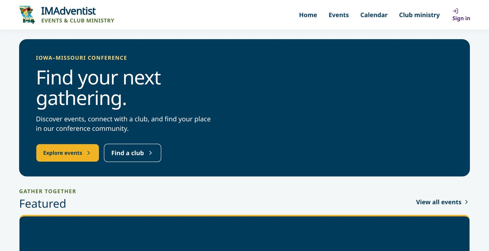
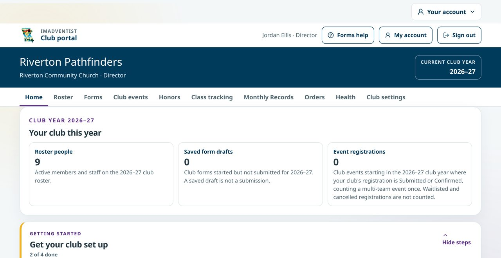
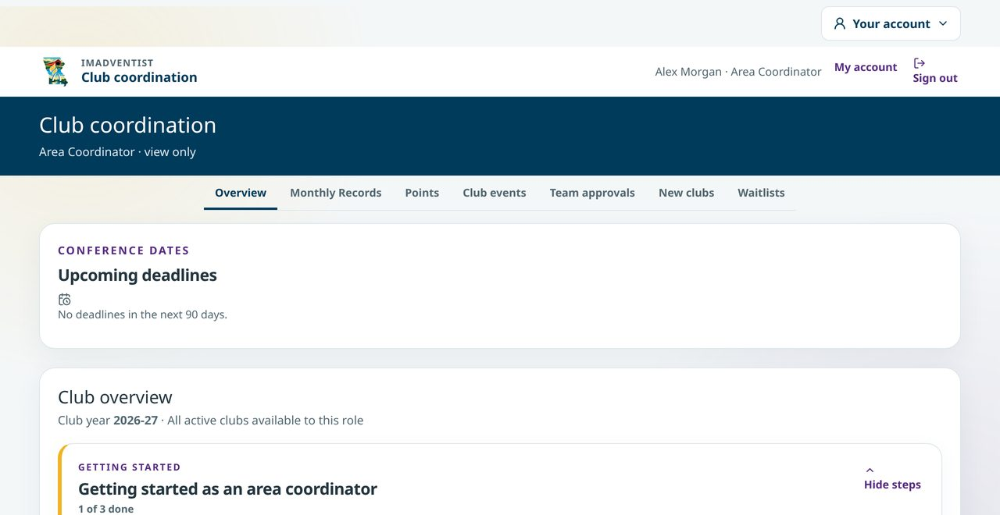

<div align="center">


# IMAdventist

**Events & Club Ministry for the Iowa-Missouri Conference of Seventh-day Adventists**

One place to find events, register a family or a whole club, run check-in, and keep Pathfinder and Adventurer club records up to date.

[](https://github.com/DurantTL/IMSDA-Events/actions/workflows/ci.yml)


[**Live site**](https://events.imsda.org) · [**Training pack**](docs/platform-documentation/2026-11-05/README.md) · [**Site rules**](docs/SITE-RULES.md) · [**Roadmap**](https://github.com/DurantTL/IMSDA-Events/issues/98)

</div>

<br>

<p align="center">
  
  
  
</p>
<p align="center"><sub>Public home · Club portal · Club coordination. All screenshots use fictional training data.</sub></p>

---

## Built for everyone in the conference

<table>
<tr>
<td width="50%" valign="top">

### 🗓️ Members and families
- Browse **events**, a filterable **calendar** and the **Club ministry** directory
- Register one person or a whole household, with live pricing, promo codes and waitlists
- Pay by card, Apple Pay or Google Pay through Square, or choose pay later
- **My registrations**: every registration in one account, with private change links and QR check-in passes
- Two-step sign-in with passkeys or an authenticator app

</td>
<td width="50%" valign="top">

### ⛺ Club directors and deputies
- **Roster** with encrypted birth dates, emergency contacts and an export builder
- **Forms**: fill in yourself or send a private link to a parent
- **Monthly Records** with meeting notes, points and on-time tracking
- **Club events**: choose who is going and register the whole club
- **Honors**, **Class tracking**, **Orders** and the **Year-End Report**

</td>
</tr>
<tr>
<td width="50%" valign="top">

### 🧭 Area Coordinators
- **Club coordination**: every club at a glance, view only
- **Who's missing what**, with one next step per club
- Monthly Records across clubs, a **Points** ranking and club event headcounts
- Team approvals, new club applications and waitlists

</td>
<td width="50%" valign="top">

### 🛠️ Event staff and administrators
- No-code **registration form builder** with templates, a question library and show-when rules
- Lodging, meals, honors weekends, capacity and ranked-interest assignments
- **Check-in** with signed QR passes and an offline-safe queue
- Email outbox with versioned templates, announcements and an attendee community
- Payments, refunds, invoices, CSV imports and audit history

</td>
</tr>
</table>

## Designed to be safe with young people's records

- **Permissions on the server.** Every page and API checks the event or club role before reading or writing.
- **Two-step sign-in** is required for administrators and for club pages that hold youth records.
- **Sensitive data is sealed.** Secrets and birth dates are encrypted; passwords, session tokens and private links are stored only as digests.
- **Careful by default.** Unsaved changes prompt before you leave a form, deletes and cancels ask for confirmation, and payments default to Square Sandbox until an explicit production unlock.
- **Accessible.** 44 px tap targets, visible focus rings, readable text sizes and mobile layouts are checked by tests and a browser audit. See [`docs/SITE-RULES.md`](docs/SITE-RULES.md).

## Documentation

| | |
|---|---|
| 🎓 **[Training pack (November 2026)](docs/platform-documentation/2026-11-05/README.md)** | Getting-started deck, presenter notes, quick-start handout and screenshot gallery |
| 📏 **[Site rules](docs/SITE-RULES.md)** | Every approved look, behavior and sign-in rule, each with its test |
| 🎨 **[Design system](docs/DESIGN-SYSTEM.md)** | Colors, type, components and layout |
| 🚀 **[Deploy with Docker](docs/DEPLOY-DOCKER.md)** | Production setup, backups and the uptime monitor |
| 🧱 **[Architecture decisions](docs/decisions/)** | Why the system is built the way it is |
| 🗺️ **[Roadmap (#98)](https://github.com/DurantTL/IMSDA-Events/issues/98)** | The ordered build queue |
| 🤝 **[Contributor and agent guide](AGENTS.md)** | Repository map, checks and workflow rules |

---

# Developer guide

## Technology

- Node.js 20.9 or newer
- Next.js App Router, React, TypeScript, and Tailwind CSS
- PostgreSQL 16 and Prisma 6
- Zod environment and route validation
- Vitest for unit tests
- Docker Compose for the local database

## Local setup

1. Install dependencies and create local environment configuration:

   ```bash
   npm install
   cp .env.example .env
   ```

   Then set `SECRET_ENCRYPTION_KEY` in `.env` to any 32 or more characters
   (for example the output of `openssl rand -base64 32`). Admin sign-in needs it
   to enrol two-factor authentication and fails without it.

2. Start PostgreSQL:

   ```bash
   docker compose -f docker-compose.yml -f docker-compose.dev.yml up -d postgres
   ```

   The dev overlay publishes the database on `localhost:5432` for host access.
   The base `docker-compose.yml` keeps Postgres internal-only and also builds and
   runs the app container for deployment — see [`docs/DEPLOY-DOCKER.md`](docs/DEPLOY-DOCKER.md).

3. Apply the committed migrations, load fictitious seed data, and publish the current local demo form:

   ```bash
   npm run db:deploy
   npm run db:seed
   npm run db:refresh-demo
   ```

4. Start the application:

   ```bash
   npm run dev
   ```

   Open [http://localhost:3000](http://localhost:3000). The root route is the public home page; choose **Sign in** to reach the staff workspace or an account.

   Local seeded credentials:

   ```text
   Email: admin@imsda-events.test
   Password: IMSDA-Local-2026!
   ```

   The same password is seeded for the `registration@`, `finance@`, `communications@`, `checkin@`, `readonly@`, and `system@imsda-events.test` role-test accounts. All are fictitious and local-only.

   **This password is for local work only and can never reach a real
   deployment.** `npm run db:seed` refuses to run with `NODE_ENV=production` or
   against any non-loopback database host, and the sign-in page shows and
   prefills these credentials only outside production. A real deployment
   bootstraps its first administrator with `npm run admin:create` — see
   [`docs/DEPLOY-DOCKER.md`](docs/DEPLOY-DOCKER.md).

   The public Women’s Retreat form includes the fictitious promo code
   `LOCAL10` after `npm run db:seed` or `npm run db:refresh-demo`. It applies
   10% off with a $50 maximum, $100 minimum subtotal, and at least 25 local
   test uses remaining after each demo refresh.

To stop the local database without deleting its volume, run `docker compose down`.

## Configuration and feature notes

<details>
<summary><strong>Square Sandbox checkout</strong></summary>

Leave the Square values blank for a friendly pay-later/unconfigured experience.
To test card checkout, copy Sandbox-only values into `.env` for
`SQUARE_APPLICATION_ID`, `SQUARE_ACCESS_TOKEN`, `SQUARE_LOCATION_ID`, and
`SQUARE_WEBHOOK_SIGNATURE_KEY`. Configure Square's notification URL to exactly
match `SQUARE_WEBHOOK_NOTIFICATION_URL`, then subscribe to `payment.created`,
`payment.updated`, `refund.created`, and `refund.updated`.

The Web Payments SDK appears on a private registration management page only
when the immutable submission selected card, or a promoted waitlist registrant
explicitly chooses card, and a positive server-derived balance remains.
Promoted registrants see card and pay-later totals before choosing; the card
fee is recomputed once from the preserved discounted subtotal. Card data is
entered directly in Square's hosted fields; the application stores neither
card data nor Square's short-lived source token.

The same embedded Web Payments SDK checkout offers Apple Pay and Google Pay
when the buyer's browser, device, wallet, and Square account support them.
Google Pay requires HTTPS in production. Apple Pay additionally requires the
public payment-page domain to be registered in both the Sandbox and Production
views of the Square Developer Console. This application serves Square's current
domain-association file at
`/.well-known/apple-developer-merchantid-domain-association`; no Apple merchant
ID or extra application environment variable is required.
See [`modules/payments/README.md`](modules/payments/README.md) for the
idempotency, webhook, refund, and production-safety boundary.

</details>

<details>
<summary><strong>Two-factor authentication</strong></summary>

`SYSTEM_ADMIN` and `EVENT_ADMIN` accounts must carry a TOTP second factor.
Enforcement happens at sign-in rather than in permission checks: a correct
password yields a challenge, not a session, and an account that has not enrolled
is sent to enrol inside that challenge — so no privileged session can exist
behind a password alone, and no authorization check has to know MFA exists.

Secrets are sealed with AES-256-GCM under a key derived from
`SECRET_ENCRYPTION_KEY` (`lib/secret-box.ts`), because verifying a code needs the
secret itself and it therefore cannot be stored as a digest like everything else
in `modules/access`. An accepted time step is recorded, so a code cannot be
replayed inside its own thirty seconds. Ten single-use recovery codes are issued
per enrolment and stored as digests; `npm run admin:reset-mfa -- --email <address>`
is the operator's way back for an account that has lost both.

Other roles may enrol voluntarily from **More → Two-factor authentication**.

</details>

<details>
<summary><strong>Account email</strong></summary>

Activation, password-reset, attendee verification, and attendee edit-code email
travel the same outbox as registration messages — with backoff, attempt history,
and the scheduled sweep — but belong to a person rather than to an event, so they take their sender from
`ACCOUNT_EMAIL_SENDER_ADDRESS` (plus `ACCOUNT_EMAIL_SENDER_NAME` and the
optional `ACCOUNT_EMAIL_REPLY_TO`) instead of an event's message settings.
Production requires that address and `RESEND_API_KEY`: a colleague who never
receives an invitation cannot obtain a credential at all.

Locally, leaving them blank keeps the previous behaviour — **Forgot password**
shows the one-time link on the page, and an invitation returns it to the
administrator — and the page says which of the two is happening.

The queued message stores a sentinel, never a token or code. The credential is
minted when the message is actually sent, so its short lifetime starts on
delivery rather than in the queue. A retry reuses the same encrypted credential
instead of invalidating the first message while the recipient is typing it.

</details>

<details>
<summary><strong>Attendee accounts</strong></summary>

Attendee identity stays separate from staff identity. A verified attendee
account claims registrations only by the normalized registration contact email;
it cannot hold an event permission. The account page supports registrations
across events, a reusable profile that prefills matching fields, optional TOTP,
Square balance payment, and contact edits protected by a single-use emailed code
bound to the session that requested it.

Staff can explicitly switch from the staff shell into a real attendee session
for their own matching account when the normalized staff email matches an
active verified attendee account. The switch endpoint accepts no attendee ID,
so it cannot select or impersonate another attendee. The staff session remains
available through **Staff workspace** (and **System management** for system
administrators) in the My account header, next to **Sign out**, which ends both sessions. Staff without a matching account
retain the read-only event preview.

Google identities use the provider subject as the durable key. A verified
same-email Google-only account may safely rebind after Google changes that
subject; mixed password-and-Google accounts require explicit support rather than
an automatic rebind. Event edit policy is stored per event, inherited from the
platform default, with `VERIFY_EVERY_EDIT` as the default and the Women's Retreat
kept on `TIERED`.

See [the attendee-account release checklist](docs/ATTENDEE-ACCOUNT-RELEASE.md)
before enabling these paths against production providers.

</details>

<details>
<summary><strong>Registration embeds</strong></summary>

Event settings generates one complete iframe-and-script block for each
published form. The embed-only layout reports its content height as fields,
steps, validation, and confirmation change; the host helper validates the
message origin, resizes the exact sending iframe, and scrolls that frame back
into view when the registrant advances or needs to correct an error. The 900px
iframe height remains a usable fallback when host JavaScript is blocked.

`EMBED_ALLOWED_ORIGINS` is the authoritative `frame-ancestors` allow-list. The
embed flow is anonymous and stateless: registration submission does not depend
on a third-party session or CSRF cookie, and payment continues from the private
top-level registration page.

</details>

<details>
<summary><strong>Attendee community</strong></summary>

Each event may opt in to a community for attendee accounts with an active
registration. An attendee accepts the event’s current conduct version before
posting, can create a post or one-level reply, choose `NONE`, `REPLIES`, or
`ALL` in-app notifications, and report content for staff review.

Communications managers can pause posts/replies, edit conduct copy, set
post-event retention, hide/restore/remove content, and resolve reports. Staff
preview is intentionally read-only; it cannot create an attendee-authored
action. The scheduled outbox sweep also performs event-end retention cleanup.
See [ADR 0004](docs/decisions/0004-attendee-community.md).

</details>

## Verification

```bash
npm run lint
npm run typecheck
npm run test
npm run build
npm run verify
```

`npm run verify` runs lint, generated route types plus TypeScript, unit tests, and the production build. CI additionally starts PostgreSQL, applies the migration, and seeds a clean database before verification.

With PostgreSQL and the app running (`npm run dev`, or a build started with `npm run start` and its production settings), the live concurrency/integration checks are:

```bash
npm run test:public-capacity
npm run test:public-access
npm run test:public-messaging
npm run test:public-roster
```

Each one creates its own throwaway event with dates relative to today, so none depends on a seeded event's deadlines. CI runs all four against the built app, plus `npm run test:eadventist-import`, which migrates and drops its own scratch database and so never touches your development data. The real-browser name-badge check, `npm run test:badge-print`, runs in its own optional CI job; see `docs/BADGE-PRINT-CHECK.md`.

## Database commands

| Command | Purpose |
| --- | --- |
| `npm run db:generate` | Regenerate the Prisma client. |
| `npm run db:migrate -- --name <name>` | Create and apply a development migration. |
| `npm run db:deploy` | Apply committed migrations without creating new ones. |
| `npm run db:seed` | Upsert fictitious `.test` foundation data. |
| `npm run db:refresh-demo` | Publish the current Women’s Retreat template only in the seeded localhost database, through the same save, test and publish workflow staff use. Replaces an out-of-date local draft with the template, and is safe to run repeatedly: when the published form already matches it, the form is left as is (the `LOCAL10` promo code is re-upserted each time). |
| `npm run db:studio` | Open Prisma Studio against the configured database. |

Never place real attendee exports, medical details, production identifiers, or credentials in migrations, seeds, tests, issues, screenshots, or commits.

## Current API

<details>
<summary>Show the current API (route reference)</summary>

- `POST /api/auth/login` validates a staff credential and creates an eight-hour database session.
- `POST /api/auth/logout` revokes the current session and expires its HttpOnly cookie.
- `POST /api/auth/password-reset/request` queues a single-use 30-minute reset credential for account email delivery; development can return a local link when delivery is unconfigured.
- `POST /api/auth/password-reset/complete` updates the scrypt password hash and revokes all prior sessions.

- `GET /api/health` answers `status`, `checkedAt` and the database check to anyone. With the `OUTBOX_SWEEP_TOKEN` or `HEALTH_MONITOR_TOKEN` bearer token, or a system-admin session, it also shows the message outbox, sweep, backups, encryption key source and the running release SHA/build ID (see `docs/DEPLOY-DOCKER.md`, "Uptime monitor").
- `GET /api/events` returns only events assigned to the development session user.
- `GET /api/events/:eventId/overview` validates the event ID, verifies active event membership and `VIEW_EVENT`, then returns database-derived totals.
- `GET|POST /api/events/:eventId/registrations` lists or creates registrations after event-scoped permission checks.
- `GET|PATCH /api/events/:eventId/registrations/:registrationId` loads or edits a registration and its primary attendee.
- `POST /api/events/:eventId/registrations/:registrationId/lifecycle/:action` performs an explicit cancel, reactivate, waitlist, or promote transition with capacity release/restore, audit history, and transactional notices.
- `POST /api/events/:eventId/registrations/:registrationId/transfer` atomically changes the registration owner/contact while preserving all registration facts, revokes prior private access, and queues notices.
- `POST /api/events/:eventId/registrations/:registrationId/attendees/:attendeeId/substitution` replaces one unchecked-in attendee in place while preserving the attendee row, answers, pricing, and capacity claims.
- `POST /api/events/:eventId/registrations/:registrationId/attendees` adds a person to a registration party.
- `POST /api/events/:eventId/registrations/:registrationId/payments` records a validated cash, check, or other manual payment.
- `GET|POST /api/events/:eventId/promo-codes` lists or creates event discounts for finance managers; the API never returns attendee data.
- `PATCH /api/events/:eventId/promo-codes/:promoCodeId` edits future uses or deactivates a code with optimistic conflict protection.
- `POST /api/events/:eventId/payments/:paymentId/refunds` records a full or partial refund against an offline payment; Square card refunds must be initiated in Square.
- `GET|POST /api/public/manage/:token/payment` returns a private server balance quote or submits an idempotent Square payment using a short-lived browser token.
- `POST /api/public/manage/:token/payment-choice` idempotently saves card or pay-later for a promoted waitlist registration, with optimistic conflict protection and a server-owned fee quote.
- `POST /api/webhooks/square` verifies the raw-body Square signature and idempotently reconciles payment and refund lifecycle events.
- `POST /api/events/:eventId/attendee-passes/resolve` verifies a signed, PII-free QR pass or resolves a manual registration confirmation code after event-scoped check-in authorization.
- `GET /api/public/manage/:token/attendee-passes/:attendeeId/qr` renders a private, no-store attendee QR pass only after registration-link authorization.
- `POST /api/events/:eventId/attendees/:attendeeId/check-in` records or safely retries an arrival using a strict client UUID idempotency key; `DELETE` explicitly undoes the active arrival while online.
- `GET|POST /api/events/:eventId/announcements` lists announcements or creates a draft.
- `PATCH /api/events/:eventId/announcements/:announcementId` publishes a draft; eligible all-attendee notices appear on the public event landing feed after their publication time.
- `PATCH /api/events/:eventId/messaging-settings` updates local-capture mode, sender/reply-to details, and internal notification recipients.
- `PUT /api/events/:eventId/message-templates/:templateId` validates and publishes a new immutable template version.
- `POST /api/events/:eventId/message-templates/:templateId/test` renders and captures a fictitious test message locally.
- `POST /api/events/:eventId/messages/process-local` claims pending outbox rows and records local capture attempts.
- `POST /api/events/:eventId/messages/process` claims committed outbox rows for local capture or the configured external email provider with retry/backoff.
- `POST /api/events/:eventId/messages/:messageId/retry` requires a stable client UUID and server-issued request fingerprint, then idempotently creates and post-commit processes one audited immutable copy.
- `GET|POST /api/events/:eventId/balance-reminders` previews the exact current balance audience or idempotently creates the reviewed batch without silently sending external email.
- `POST /api/events/:eventId/messages/:messageId/resend-confirmation` creates an audited immutable confirmation copy, optionally to one corrected destination without changing the contact record.
- `GET /api/events/:eventId/exports/registrations` downloads a formula-safe CSV roster and balance report.
- `GET|POST /api/events/:eventId/memberships` lists or creates staff assignments for event administrators.
- `PATCH /api/events/:eventId/memberships/:membershipId` changes a staff role or active status while preserving at least one active event administrator.
- `GET /api/events/:eventId/imports` lists recent staging runs for authorized event administrators.
- `POST /api/events/:eventId/imports/preview` validates a CSV, stores an immutable source snapshot per row, and prepares CREATE, UPDATE, SKIP, or ERROR decisions without changing registrations.
- `GET /api/events/:eventId/imports/:importRunId` returns the reviewable records and field-level differences for one run.
- `POST /api/events/:eventId/imports/:importRunId/commit` applies a reviewed, error-free run to the local database exactly once.
- `GET /api/events/:eventId/imports/:importRunId/exceptions` downloads formula-safe warnings and errors as CSV.
- `GET /api/events/:eventId/imports/reconciliation` returns cumulative created, updated, skipped, and error totals.
- `GET|POST /api/events/:eventId/forms` lists event forms and templates or creates a local draft from a template.
- `GET|PATCH /api/events/:eventId/forms/:formId` returns one versioned form or saves its draft with optimistic conflict protection.
- `POST /api/events/:eventId/forms/:formId/test-submissions` validates and stores a fictitious response against an exact form version.
- `POST /api/events/:eventId/forms/:formId/publish` publishes a draft as an immutable local version and archives the prior published version.
- `GET|POST /api/events/:eventId/program-assignments` previews a deterministic ranked-interest assignment or applies the exact reviewed fingerprint as a new immutable, audited run.
- `GET /api/events/:eventId/program-assignments/:runId/roster` downloads the event-authorized, formula-safe CSV for one frozen assignment run.
- `GET|PATCH /api/events/:eventId/community` returns the staff moderation workspace or updates settings, post state, and reports for communications managers.
- `GET|POST /api/attendee/events/:eventId/community` serves conduct, posts, replies, reports, notification preferences, and read state only to an actual attendee session with an active registration.
- `POST /api/public/events/:eventSlug/forms/:formSlug/registrations` validates, prices, capacity-checks, waitlists if necessary, and saves an anonymous registration idempotently.
- `POST /api/public/events/:eventSlug/forms/:formSlug/promo-code` returns a same-origin, rate-limited, server-calculated display quote without consuming a use.
- `GET|PATCH /api/public/manage/:token` resolves a hash-only, expiring private link and permits contact-only self-service changes.
- `POST /api/webhooks/resend` verifies provider events and reconciles delivery status idempotently.
- `POST /api/webhooks/ses` receives Amazon SNS reports for SES: verifies the SNS signature, the allowed topic and account, then records deliveries, bounces and complaints idempotently by SNS message id and suppresses hard-bounced or complained addresses (#863).

The browser receives only a random opaque session token in an HttpOnly, SameSite cookie. The database stores its SHA-256 digest, expiry, and revocation state. Staff passwords use salted scrypt hashes; reset tokens are also stored only as digests. Mutation routes require a same-origin request in addition to authentication and event authorization.

</details>

## Architecture

```text
app/                  pages, layouts, and route handlers
components/           reusable shell and brand components
modules/access/       credentials, sessions, recovery, memberships, roles, and capability rules
modules/events/       event reads, selection, and overview data
modules/people/       permanent identity and household boundary
modules/registrations registration and attendee boundary
modules/payments/     payment and refund boundary
modules/promo-codes/  bounded discount, quote, redemption, and immutable snapshot boundary
modules/checkin/      check-in and reconciliation boundary
modules/communications announcements, versioned templates, transactional outbox, and delivery-history boundary
modules/community/    attendee posts, conduct, reports, moderation, notifications, and retention
modules/forms/        registration templates, definitions, tests, and immutable versions
modules/reporting/    safe operational reports, grouped retreat packets, and printable projections
modules/audit/        transaction-compatible audit interface
integrations/         future external adapters only
prisma/               schema, migration, and fictitious seed
scripts/imports/      staging CSV contract and operator notes
tests/                permission and domain tests
docs/decisions/       architecture decision records
```

The platform begins as a modular monolith. People and households persist across events; registrations, attendees, payments, refunds, check-ins, announcements, audits, and imports are event-scoped. PostgreSQL becomes authoritative only after staging imports, reconciliation, and cutover approval.

See [ADR 0001](docs/decisions/0001-foundation-architecture.md) for the decision and consequences.

## Design direction

The product name, descriptor and symbol are defined once in [`lib/brand.ts`](lib/brand.ts) (**IMAdventist**, *Events & Club Ministry*, `public/brand/imadventist-symbol.png`); see the [branding inventory](docs/BRANDING-IMADVENTIST-INVENTORY.md). The workspace preserves the calm operational structure of WR26 App V2 with the conference palette:

- IMSDA navy `#003B5C`
- IMSDA purple `#582C83`
- IMSDA gold `#F0B323`
- Noto Sans typography
- desktop sidebar and mobile bottom navigation
- event selector plus Overview, People, Check-in, Communications, and More routes
- working event selection that follows staff between pages

The current UI writes authoritative operational state to the configured IMAdventist PostgreSQL database. Staff sign-in/out, local recovery, event role/status management, registration create/edit, reviewed whole-registration transfer, in-place attendee substitution, party attendees, manual payments, partial offline refunds, signed attendee passes, camera/manual pass resolution, partial-party check-in/online undo, recoverable device-local offline check-in, CSV export, audit history, announcement draft/publish with a filtered public all-attendee feed, reviewed CSV imports, registration-form draft/test/publish, and message-template/outbox workflows are functional. A published form is available at `/register/{event-slug}/{form-slug}` and through an allow-listed, automatically resizing `/embed/{event-slug}/{form-slug}` iframe. It can save either one attendee or an ordered household/group roster locally. It records attendee-scoped answers, pricing, capacity claims, and the exact confirmation after commit. A private management link can collect the remaining card balance through Square Sandbox when configured; no real payment is possible with the default configuration.

## Registration builder workflow

<details>
<summary>Show the registration builder workflow</summary>

1. Sign in as an event administrator or registration manager and open **Registration form**.
2. Create a form from Simple RSVP, Retreat registration, Household interest, Women’s Retreat 2026, Man Camp 2026, Spring Camporee 2026, or Camp Meeting 2026, or edit a saved event draft.
3. Add, remove, and reorder sections and fields; insert reusable modules; configure labels, stable field keys, field types, scope, choices, help text, and required status.
4. Configure conditional visibility, ordinary versus capacity/ranked-interest choices, per-choice limits, prices, automatic fees, and optional date-driven late prices. Add the **Promo code** drop-in module when the event offers finance-managed discounts. Use the calculation-preview date to test both sides of a pricing deadline.
5. Save the draft, complete the live preview with fictitious responses, and run a test submission. Validation feedback is attached to the exact saved version.
6. Publish a form for the first time only after a valid test passes; later drafts publish without a retest (a test stays optional). The published definition becomes immutable, its public registration link activates, and a later edit automatically creates the next draft version while the prior public version remains live.

The builder supports short and long text, email, phone, dropdown, radio, multiselect, ranked choice, checkbox, date, number, and automatic-fee fields. Conditional logic, scheduled late pricing, card-fee gross-up, bounded promo-code rules, repeatable attendee modules, public rendering, server-side validation and pricing, immutable answer snapshots, duplicate-submit idempotency, serializable capacity reservations, automatic waitlists, private links, external email delivery, and Square payment collection are implemented. File uploads remain separate work.

</details>

## Staging import workflow

<details>
<summary>Show the staging import workflow</summary>

1. Sign in as an event administrator and open **Imports**.
2. Download the template or sample CSV, or choose a compatible `.csv` file up to 2 MB and 2,000 data rows.
3. Select **Preview import**. Review row validation, identity matches, proposed actions, warnings, and field-level differences. Preview never changes a registration.
4. Correct and re-upload files with errors. Warning-only runs remain eligible for a reviewed commit.
5. Select **Commit to local database**, acknowledge the confirmation, and commit once. Repeating the same upload returns the existing run; repeating commit is safe and does not duplicate data.
6. Use reconciliation totals and the exception CSV to document the result.

The format template is available at `/fixtures/wr26-import-template.csv`; a wholly fictitious walkthrough file is available at `/fixtures/wr26-import-sample.csv`. See [`scripts/imports/README.md`](scripts/imports/README.md) for the exact field contract and matching rules.

</details>

## Build status and next review gate

The detailed built-versus-remaining matrix and the behavior comparison with `DurantTL/WR26-IMSDA` are in [the build status and WR26 gap audit](docs/BUILD-STATUS-AND-WR26-GAP-AUDIT.md).

Before this workspace holds real attendee, medical, or payment data, read [the production readiness review](docs/PRODUCTION-READINESS-REVIEW.md). It reviews the build plan and the shipped features against what a real deployment requires, and sequences the remaining work into ten items.

[The production readiness progress log](docs/PRODUCTION-READINESS-PROGRESS.md) tracks that sequence: what has been implemented, what is deliberately deferred, and why. The review's three blocking findings — no path to a real administrator account, a single bad environment variable silently 403ing every write, and no backups — are addressed. MFA is complete; medical-data encryption remains a platform backlog item outside the Women’s Retreat release scope, and the deployment/Square Sandbox rehearsal remains in progress.

Signed attendee QR passes, camera/manual staff resolution, the recoverable offline check-in conflict queue, reviewed balance reminders, corrected-address confirmation copies, bounded promo-code administration, whole-registration transfer, in-place attendee substitution, printable pass sheets, grouped retreat packets, and the moderated attendee community are complete. Scheduled/targeted announcements remain later work. Production Square activation remains gated behind approved credentials, an exact public webhook URL, operational refund testing, and the explicit production unlock.

---

<p align="center"><sub>IMAdventist is built for the Iowa-Missouri Conference of Seventh-day Adventists. Questions: <a href="mailto:support@imsda.org">support@imsda.org</a></sub></p>
