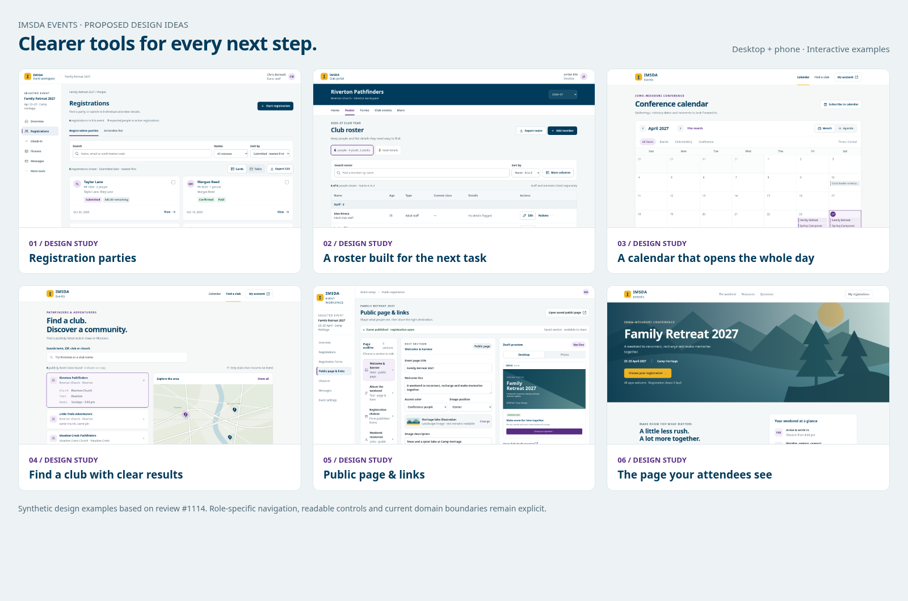

# Six mockup design ideas

Based on review [#1114](https://github.com/DurantTL/IMSDA-Events/issues/1114). These are proposed interactive examples, not production screenshots or a claim of implementation. They preserve the previously accepted role separation; the new layouts and column/preview refinements remain for review.

- [Seven-page mockup PDF](design-ideas.pdf)
- [Download the interactive examples](interactive-examples.zip) — extract and open `index.html`; no build or server required.
- [Design notes, fixtures and boundaries](design-notes.md)
- [Example validation](validation.json)

## Desktop and phone examples

| Design idea | Desktop | Phone | Existing implementation owner |
|---|---|---|---|
| Registration parties | [Image](screenshots/registrations-desktop.png) | [First viewport](screenshots/registrations-phone.png) | #181 · #1116 |
| A roster built for the next task | [Image](screenshots/roster-desktop.png) | [First viewport](screenshots/roster-phone.png) | #1112 |
| A calendar that opens the whole day | [Image](screenshots/calendar-desktop.png) | [First viewport](screenshots/calendar-phone.png) | #1117 |
| Find a club with clear results | [Image](screenshots/clubs-desktop.png) | [First viewport](screenshots/clubs-phone.png) | #1118 |
| Public page & links | [Image](screenshots/event-editor-desktop.png) | [First viewport](screenshots/event-editor-phone.png) | #448 · #283 · #284 · #1115 |
| The page your attendees see | [Image](screenshots/event-public-desktop.png) | [First viewport](screenshots/event-public-phone.png) | #283 · #284 |

The registration hub keeps cards and demonstrates a proposed compact table. Attendee and meal views explicitly change row population; the club roster stays in a director's club/year workspace. Calendar and club finding remain public experiences. Public page & links is an event-scoped organizer proposal; the attendee-facing event page has public navigation.

## Extra task and interaction states

- [Optional registration table](screenshots/registration-table.png)
- [Meal-planning view: seven active attendees](screenshots/meal-planning.png)
- [Roster Details needed: two members](screenshots/roster-details-needed.png)
- [Calendar complete dated agenda](screenshots/calendar-day-detail.png)
- [Unsaved address edit with the saved sharing address preserved](screenshots/event-sharing-draft.png)
- [Registration name sort with matching order description](screenshots/registration-sort-name.png)
- [Public registration choices](screenshots/event-registration-choices.png)

## Try the local interactions

Search, status/category changes, card/table/task views, dialogs, local roster edits and saved-versus-draft copying work in the archive. Open `prototype/event-editor.html?scenario=save-error` from the gallery's failed-save link, edit a field and Save to see recovery. Copying uses reserved `events.example.test` examples, with a manual fallback where clipboard access is restricted.

All people, counts, dates, amounts, map towns and operational states are synthetic. The map is illustrative. Other operational destinations explain the existing workflow and perform no real action. Local edits reset on reload. No production API, registration, payment, message, publication, upload, deletion or permission change is performed.

## Checks and implementation status

All 24 page/width cases (six screens at 360, 390, 768 and 1440px), three gallery widths and six independent interaction bundles passed. Final checks found no document overflow, broken local image assets, JavaScript errors or open QA findings. Ordinary controls/help retain a 14px floor and phone actions 44px; the miniature editor preview intentionally scales its contents.

Desktop screenshots capture 1440 × 1080; phone screenshots capture the first 390 × 1000 viewport. The whole prototype page remains scrollable. The seven-page PDF was visually reviewed. Archive integrity and local HTML/CSS references were checked. These checks validate the examples, not production behavior. #98's queue and #448's existing scope decision remain unchanged.
