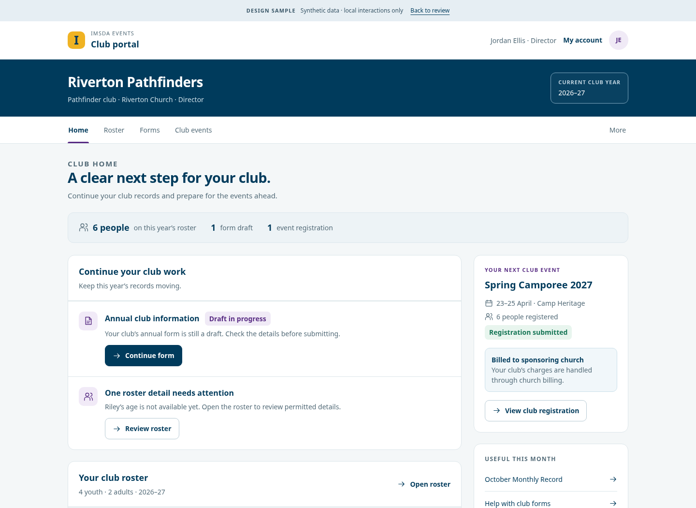
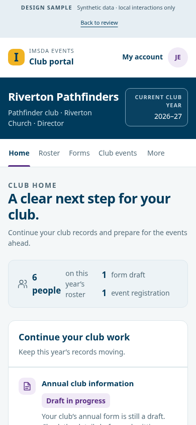
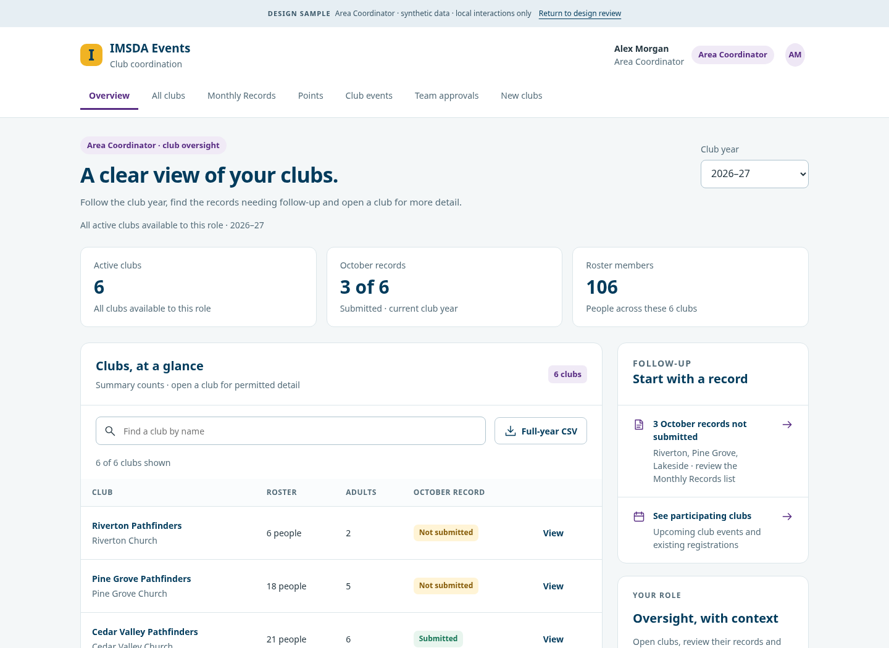
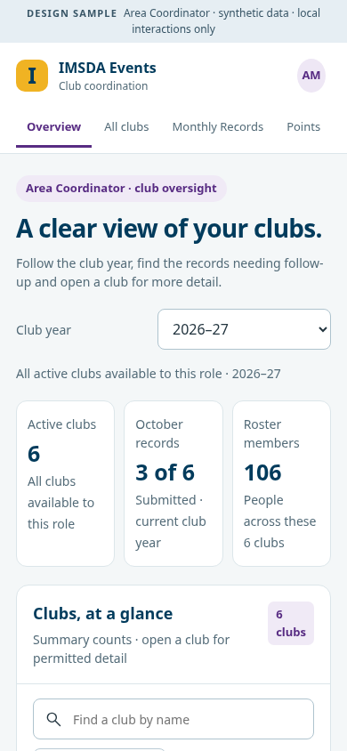
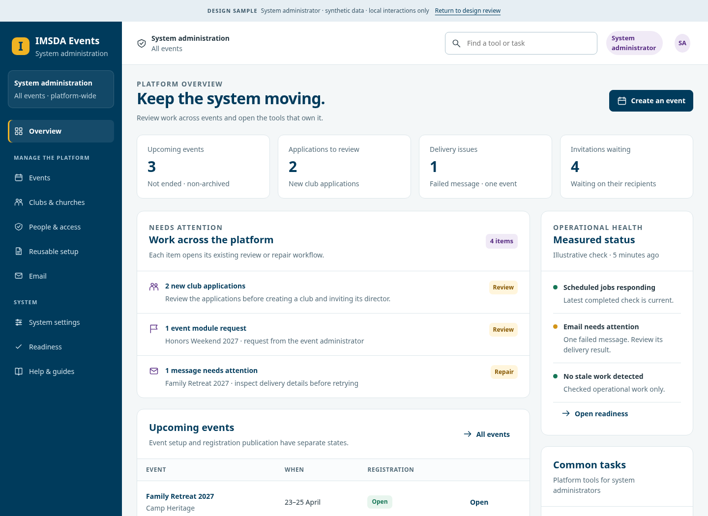
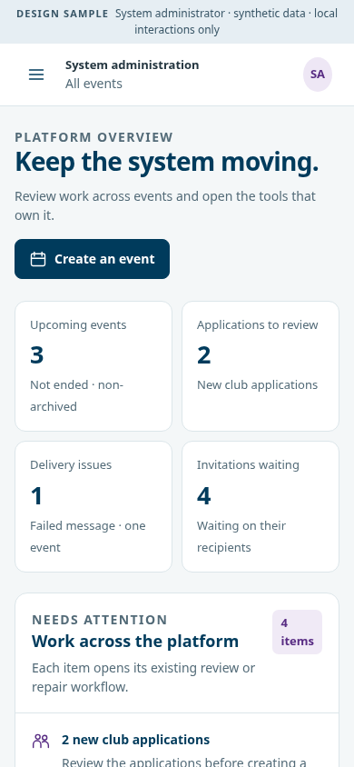

# Accepted role workspace design reference

Design index: [#1109](https://github.com/DurantTL/IMSDA-Events/issues/1109). Caleb accepted the corrected four-role examples and requested detailed implementation issues on October 20, 2026 (America/Chicago).

The reference is **one visual language with four distinct workspaces**. The earlier review’s shared staff-style shell is superseded as the role-layout reference. This package records presentation direction and current role boundaries; it is not a running production feature or a permission-policy change.

## Review the assets

- [Five-page corrected comparison PDF](comparison.pdf)
- [Download the offline interactive prototype](interactive-prototype.zip) — extract and open `role-design-samples.html`; no build or server is required.
- [Source-based role and permission contract](evidence/role-contract.md)
- [Director portal implementation evidence (#1112)](evidence/director-implementation.md)
- [Coordinator workspace implementation evidence (#1113)](evidence/coordinator-implementation.md)
- [Design notes and current versus proposed distinctions](design-notes.md)
- [Detailed per-role specifications](specs/)

The archive contains the exact static HTML/CSS/JavaScript, fonts/license, images and local demonstrations used for review. It is deliberately stored as a reference archive so it does not become production application source or introduce a second registration renderer.

## The four workspaces

| Role | Main record scope | Navigation and job |
|---|---|---|
| Attendee | Own accessible registrations | Personal Overview / My registrations / Profile; event cards and permitted next steps. |
| Director | Selected club and club year | Club identity, roster, forms, event registration and capability-gated club tools. |
| Area Coordinator | Active clubs available to this role | Club/report oversight; view-only club data and narrow existing Team approval paths. |
| System administrator | Platform across events | Grouped system navigation, setup/access, cross-event work and measured operational health. |

Review navigation stays outside the product screens. A real context switch offers only workspaces the signed-in person is already authorized to enter.

## Shared design elements

- Reference palette: navy `#003b5c`, purple `#582c83`, gold `#f0b323`, ink `#243640`, muted `#536b78`, border `#dce6ea`, surface `#f4f7f8`.
- Sample type: Noto Sans 400/700. Integrate through current production tokens/fonts where appropriate; the mockups do not authorize a global style or font migration.
- Reuse accessible inputs, buttons, statuses, empty/error states, dirty-navigation and dialog patterns. Preserve the current 14px ordinary staff/help text floor and 44px phone targets.
- Keep context, current state, consequence and next action visible. A shared green badge cannot combine registration, payment, invoice, assignment, screening, email delivery or arrival states.
- The same visual primitives can support different shells. The personal/club/coordination portals should not inherit the administrator sidebar.

## Fixture consistency and domain meaning

| Example | Illustrative data and contract |
|---|---|
| Taylor Lane, ordinary attendee | Family Retreat #FR-1024: 2 people, $80 total, $40 paid, $40 remaining. Waitlisted request has no payment due; cancelled records remain history. No club or staff grant. |
| Jordan Ellis, director | Riverton Pathfinders, 2026–27: 6 roster members (4 youth, 2 adults), annual form draft, October Monthly Record not submitted. Spring Camporee has 6 people and is billed to the sponsoring church. |
| Alex Morgan, coordinator | 6 available clubs, 106 roster members, 3 of 6 October records submitted. Riverton matches the director example. No invented ministry/area filter or generic approval authority. |
| System administrator | 3 upcoming events, 2 new-club applications, 1 email-delivery issue and 4 waiting invitations. Needs-attention counts represent work items, not just rendered rows. Health is illustrative measured status, separate from human readiness. |

These values are demonstration fixtures, not production requirements. Implementation must use authorized owning services and truthful counts. Current coordinator source selects all active clubs; ministry/area changes remain with #840/#843. Multiple people on a registration do not establish household identity or guardian authority.

## Screenshots

### Attendee — personal registration portal

Attendee phone view

### Director — club and working year

Director phone view

### Area Coordinator — club oversight

Coordinator phone view

### System administrator — platform workbench

Administrator phone view

## Implementation tracking

Design index: [#1109](https://github.com/DurantTL/IMSDA-Events/issues/1109). Documentation reference PR: [#1110](https://github.com/DurantTL/IMSDA-Events/pull/1110).

| Implementation owner | Detailed specification |
|---|---|
| [#1111 — Attendee portal](https://github.com/DurantTL/IMSDA-Events/issues/1111) | [Personal registrations and next actions](specs/attendee.md) |
| [#1112 — Director portal](https://github.com/DurantTL/IMSDA-Events/issues/1112) | [Club/year workspace and roster](specs/director.md) |
| [#1113 — Coordinator workspace](https://github.com/DurantTL/IMSDA-Events/issues/1113) | [Club oversight and report follow-up](specs/coordinator.md) |
| [#1073 — Admin design index](https://github.com/DurantTL/IMSDA-Events/issues/1073) | [System-admin role distinction](specs/admin-1073.md) |
| [#1074 — Admin navigation](https://github.com/DurantTL/IMSDA-Events/issues/1074) | [Scope and destination search](specs/admin-1074.md) |
| [#1075 — Admin dashboard](https://github.com/DurantTL/IMSDA-Events/issues/1075) | [Counts, health and readiness](specs/admin-1075.md) |
| [#1076 — Admin settings](https://github.com/DurantTL/IMSDA-Events/issues/1076) | [Ownership, change impact and recovery](specs/admin-1076.md) |
| [#1077 — Role-aware help](https://github.com/DurantTL/IMSDA-Events/issues/1077) | [Learning and future feature homes](specs/admin-1077.md) |

Implementation remains open. The admin issues were expanded in place and their superseded generic layout-review gate removed after acceptance; no new `codex-ready` labels or queue changes were made.

## Implementation ownership

The attendee presentation is a bounded child of #109/#99. Director/coordinator presentation extends #68 and delivered portal work. Administrator presentation stays in #1073–#1077. #108/#160 own gateways; #554 owns linked account/sign-in direction. #1100/#1101 and other corrective findings retain independent scopes.

The accepted visual direction does not reorder #98 or add codex-ready outside its current frontier. Build bounded slices through current owners. No accounting, identity, readiness, communications, protected-data or module-activation rule is changed by storing these references.

## Validation and provenance

- Source boundaries reviewed at `8eb81d7d`; relevant status refreshed through `72a6cb21`.
- Static reference validation: 16 screen/width cases (360, 390, 768, 1440), 11 role/state checks, and three gallery widths passed. The exported PDF is five pages and was visually reviewed.
- Builders additionally exercised roster search, dirty Close/Escape recovery, local saves, waitlist/payment labels, read-only coordinator detail, and settings-impact review.
- These checks validate the mockups. Production implementation still requires proportional tests and the repository’s required CI/mobile checks for each affected code slice.
- All people, addresses, dates, records, amounts and operational states are synthetic. No production data was used.
