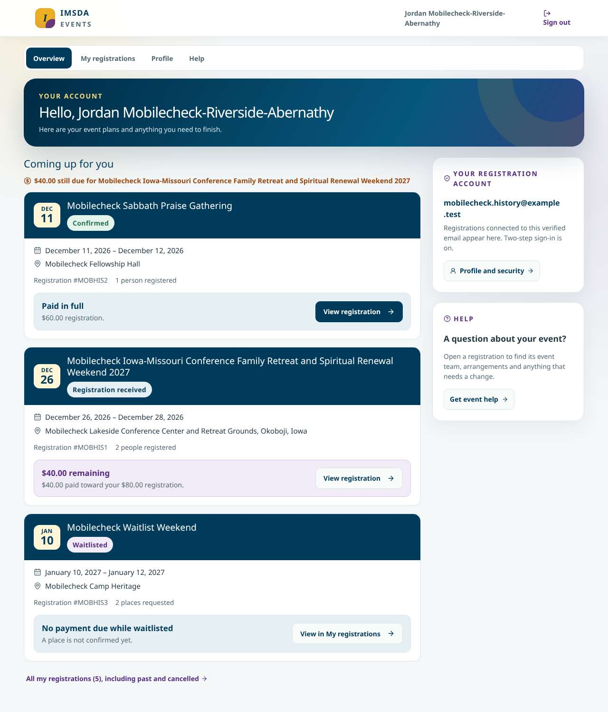
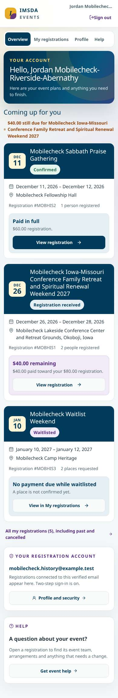
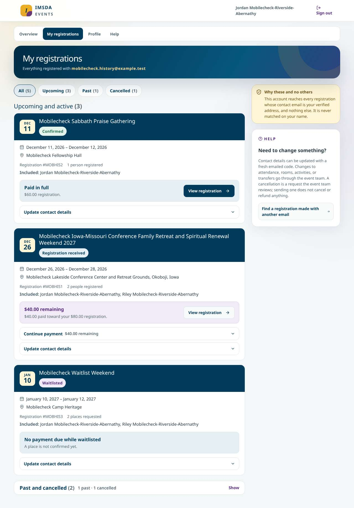
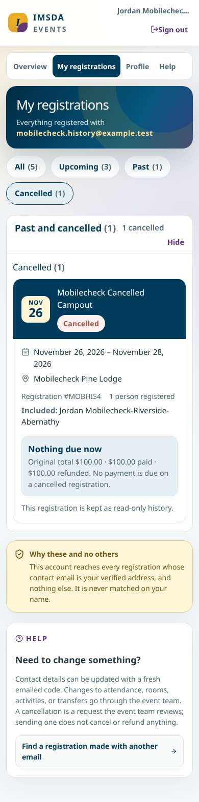
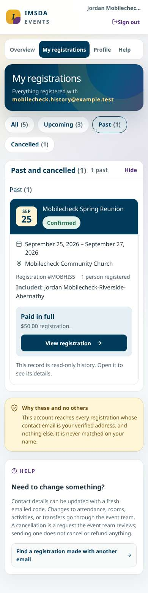
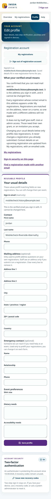
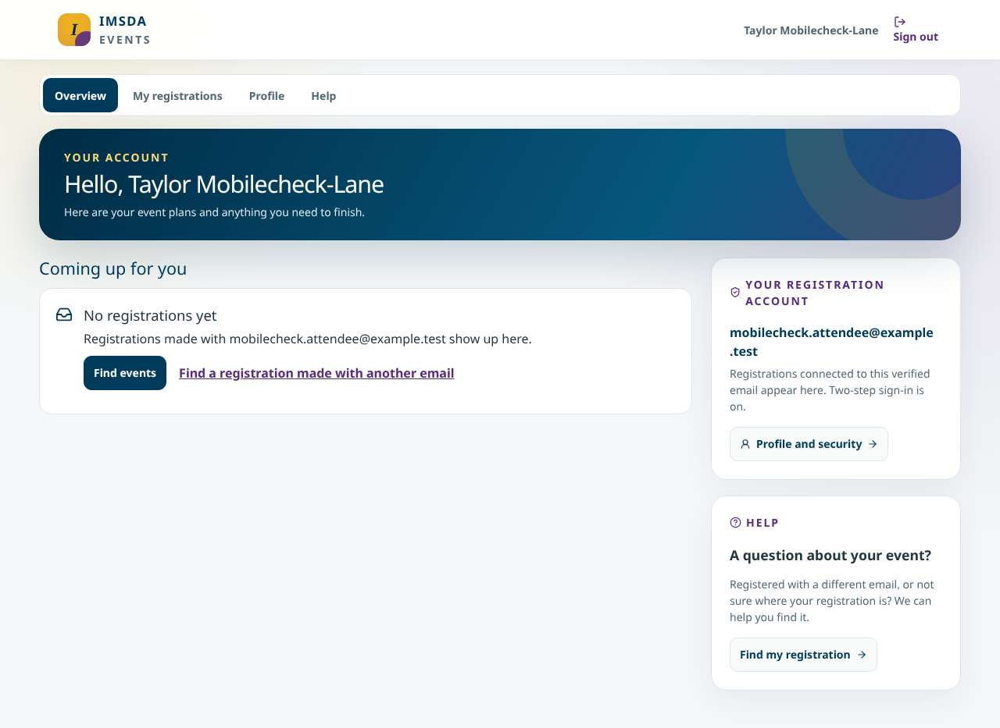
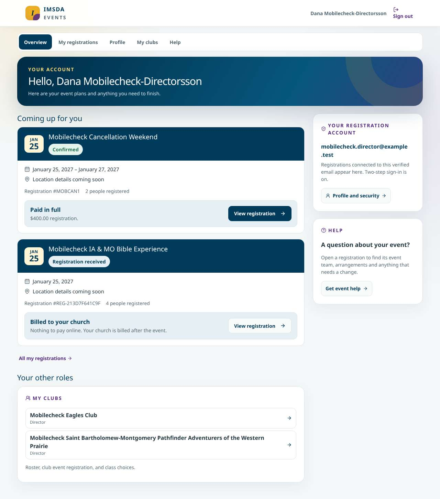

# Attendee portal implementation evidence (#1111)

Issue: [#1111](https://github.com/DurantTL/IMSDA-Events/issues/1111). It was built in two slices: [#1175](https://github.com/DurantTL/IMSDA-Events/issues/1175) (Overview, PR #1179) and [#1176](https://github.com/DurantTL/IMSDA-Events/issues/1176) (My registrations and Profile, PR #1181). This page records what the delivered pages show and how each acceptance criterion was checked. All screenshots come from a local production build with synthetic `mobilecheck` data, taken on October 28, 2026. They show this build, not a deployment.

## Fixtures

The phone-layout audit (`scripts/verify-mobile-layout.ts`) signs in three portal accounts:

| Account | Grants | Registrations | What it proves |
|---|---|---|---|
| `mobilecheck_account_attendee` (Taylor Mobilecheck-Lane) | None | None | Plain attendee: three tabs plus Help, and the calm empty state |
| `mobilecheck_account_history` (Jordan Mobilecheck-Riverside-Abernathy) | None | Five, one per lifecycle state (below) | Plain attendee: every card state, history and filters |
| `mobilecheck_account_director` (Dana Mobilecheck-Directorsson) | Club director | Confirmed, and church-billed | Only the real extra workspace (My clubs) is added |

The history account's registrations match by verified email, the same way the portal does:

| Registration | Lifecycle | Card shows | Where it appears |
|---|---|---|---|
| Long-named family retreat, 2 people, $80 total, $40 paid | Submitted | "Registration received", "$40.00 remaining", "$40.00 paid toward your $80.00 registration", Continue payment | Coming up |
| Sabbath Praise Gathering, $60 paid | Confirmed | "Confirmed", "Paid in full" | Coming up |
| Waitlist Weekend, $120 quoted, nothing paid | Waitlisted | "Waitlisted", "2 places requested", "No payment due while waitlisted", no Continue payment, no hub link ("View in My registrations") | Coming up |
| Cancelled Campout, $100 paid, $100 refunded | Cancelled | "Nothing due now", "Original total $100.00 · $100.00 paid · $100.00 refunded. No payment is due on a cancelled registration.", read-only | History, Cancelled filter only |
| Spring Reunion, ended 30 days ago, $50 paid | Confirmed (past) | "Paid in full", read-only history with View registration | History, Past filter only |

The audit fails if this lifecycle and money text is missing. It checks the received wording and the $40 balance on Overview, and the waitlisted wording, "places requested" and the balance on My registrations. It also checks the Past filter, and the cancelled wording with its refund on the Cancelled filter.

## Screenshots

| | |
|---|---|
| Overview, desktop |  |
| Overview, phone (390px) |  |
| My registrations, desktop |  |
| Cancelled filter, phone |  |
| Past filter, phone |  |
| Profile, phone |  |
| Empty state, desktop |  |
| Account with a club grant, desktop |  |

## Acceptance criteria and checks

1. **Header, tabs, event-first hierarchy, account/help column, phone composition.** A plain attendee sees Overview, My registrations, Profile and Help, and nothing for staff, clubs or admin. The director also sees My clubs. On a phone the cards come before the account and help cards. Checked by `tests/attendee-overview-1175.test.ts`, `tests/portal-labels-742.test.ts` and the screenshots.
2. **Only registrations and actions the existing rules allow.** Matching is by verified email (`listRegistrationsForVerifiedEmail`). The actions come from `registrationActions` and the existing attendee routes, and nothing on the server changed. Checked by `tests/attendee-registrations-1176.test.ts`; the plain and director fixtures are above.
3. **Submitted, confirmed, waitlisted, cancelled/refunded and past.** Covered by the history fixture and its audit text checks, plus unit tests in both slice test files. Upcoming selection and money due use the #1100 helpers (`upcomingRegistrations`, `accountAmountDue`).
4. **Links enter current workflows.** View registration goes to `/account/events/<slug>`, and only for submitted and confirmed records, which are the statuses that page loads. A test pins this to the hub's filter. `/manage/[token]` is unchanged. Load-failure retry, the empty state and the filtered-empty state are covered by unit tests.
5. **Keyboard, focus, disclosures, long content, text enlargement, narrow screens.** Manual Playwright pass on October 28, 2026, using the history account:
   - Tab order on Overview and My registrations is header, Sign out, tabs, filters, cards and their actions, then the help column. Every stop had a visible focus ring.
   - The "Past and cancelled" history and the action disclosures (Continue payment, Update contact details) open with Enter and close with Space. They are native `
`, so there is no dialog focus trap to manage.
   - My registrations has a polite live region for its status messages.
   - At 200% root text size, Overview, My registrations and the Cancelled filter fit at 390px and at 1280px. Profile overflowed at 390px because the long signed-in email could not wrap. That is fixed in this change (`.profile-account-email`, tested) and confirmed with the same rule injected.
   - The audit passes for every account page at 360, 390, 768, 1024 and 1280px (80 page/width combinations).
6. **Screenshots and recorded checks.** This page.

## Differences from the prototype, kept on purpose

- The greeting sits on the portal's existing navy banner, and the tabs use the shared pill style. Both come from the shared portal styles accepted in #1175. Changing them would also restyle the club and coordinator portals (#1112, #1113).
- On wide screens the header shows the full name, wrapping to a second line when needed. Phones still shorten it with an ellipsis to keep the header to one row. The greeting directly below always shows the full name.
- The filled View registration button goes to the first card that opens an event page, by date, rather than to the card with a balance. That rule comes from #1176. A card with a balance is still marked by its purple money block and "remaining" headline, and by the amount-due line above the cards.
- There is no receipt action, because no on-demand receipt service exists (see #1176). A paid past record keeps its money summary instead.
