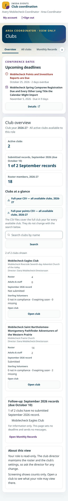
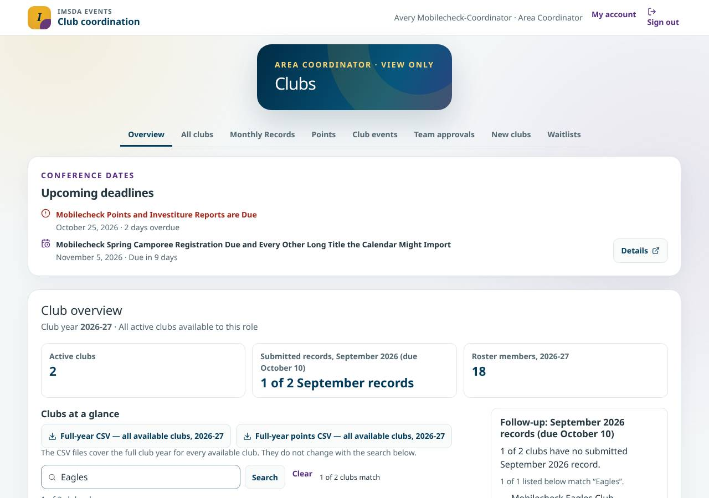
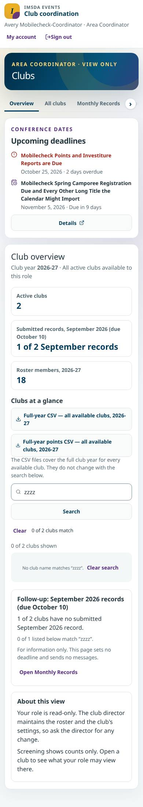
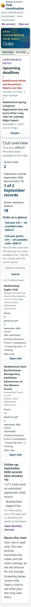
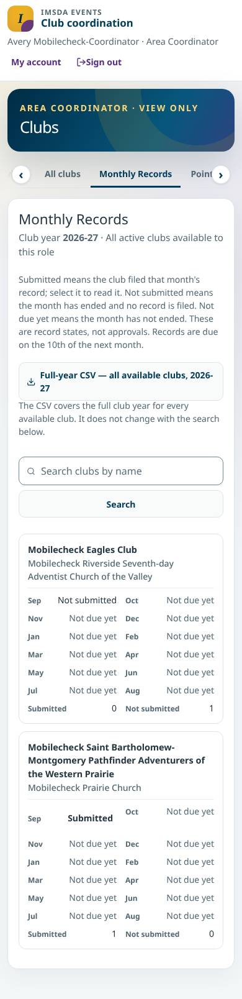
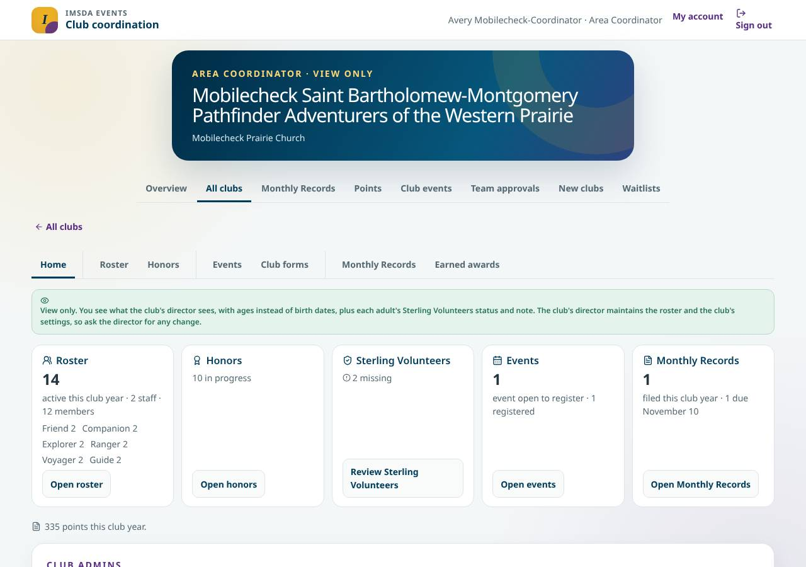
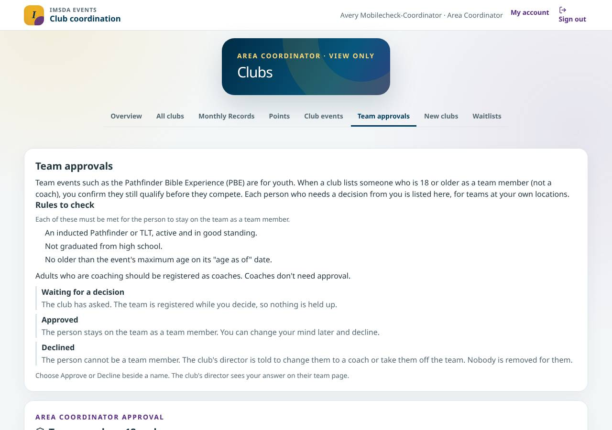
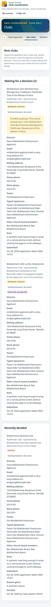

# Coordinator workspace implementation evidence (#1113)

Issue: [#1113](https://github.com/DurantTL/IMSDA-Events/issues/1113). It was built in two slices: [#1186](https://github.com/DurantTL/IMSDA-Events/issues/1186) (masthead, task navigation and Overview) and [#1187](https://github.com/DurantTL/IMSDA-Events/issues/1187) (one club, Monthly Records, Points, Club events, Team approvals and New clubs). This page records what the delivered pages show and how each acceptance criterion was checked. The #1113 wrap-up change adds one fix:

- at 200% text on a phone, the Overview, Club events and one-club pages no longer scroll sideways. On the coordinator's card tables (Overview, Club events and Points), card labels move above their values when the text is large; the Open club button sits under its label, and a long leader email wraps in the club's list.

All screenshots come from a local production build with synthetic `mobilecheck` data, taken on October 28, 2026. They show this build, not a deployment.

## Fixtures

The phone-layout audit (`scripts/verify-mobile-layout.ts`) signs in `mobilecheck_account_area` (Avery Mobilecheck-Coordinator), an account with an active Area Coordinator grant and a completed second sign-in step. It sees two active clubs:

- club A, with a deliberately long name, 14 roster people and a submitted September record;
- Mobilecheck Eagles Club, with 4 roster people, no adults and no September record.

There are also two synthetic new-club applications, one with a very long email address.

## Screenshots

| | |
|---|---|
| Overview, desktop |  |
| Overview, phone (390px) |  |
| Overview, search for one of two clubs, desktop |  |
| Overview, search with no match, phone |  |
| Overview at 200% text, phone (360px) |  |
| Monthly Records, phone |  |
| One club, desktop |  |
| Team approvals, desktop |  |
| New clubs, phone |  |

## Acceptance criteria and checks

1. **An account and oversight portal, with no platform sidebar, role administration, generic approval queue or role picker.**
   - The masthead shows IMSDA Events, "Club coordination", the person's name and "Area Coordinator", with My account and Sign out. The navigation is Overview, All clubs, Monthly Records, Points, Club events, Team approvals and New clubs.
   - Checked by `tests/coordinator-overview-1186.test.ts` ("has no staff or system links and no role picker", "lists the seven destinations with Overview first, keeping every route") and the screenshots.
2. **Existing routes stay reachable with the right navigation; Profile/security and Waitlists follow their owners.**
   - Every earlier route keeps its meaning. All clubs stays lit on a coordinator's club pages (`/account/area/...`).
   - Waitlists appears only for a real coordinator, never during a staff act-as or a pending second step. Profile and security stay under My account.
   - The one-club menu is Home, Roster, Honors, Events, Club forms, Monthly Records and Earned awards: the coordinator subset, not the director's.
   - Checked by `tests/coordinator-overview-1186.test.ts` ("adds Waitlists only when the owner rule allows it", "shows the active destination…", "coordinator shell header wiring") and `tests/coordinator-one-club-1187.test.ts`.
3. **Every number comes from the current queries, with month, year, unit and denominator; missing data is not zero.**
   - The Overview reads "Club year 2026-27 · All active clubs available to this role", "1 of 2 September records" (with the due date) and "Roster members, 2026-27: 18". All of it comes from `getAreaClubsSummary` for the queried year.
   - A failed read says "unavailable" with a retry, never 0 or Submitted.
   - Checked by `tests/coordinator-overview-1186.test.ts` ("overview numbers come from the clubs the owning query returned", "shows unavailable, never zero clubs or Submitted…") and `tests/coordinator-destinations-1187.test.ts` (each page's unavailable state).
4. **A submitted record is view only; no roster, settings, new-club decisions or director tools, even by direct URL or modified request.**
   - Checked by `tests/coordinator-one-club-1187.test.ts` ("a direct URL cannot reach the director's tools": no roster editor, Class tracking, Club settings or Health route under the one-club pages; Orders and Supplies answer 404; the roster API and Orders loaders refuse a coordinator and a staff act-as).
   - The separate event Health Record viewer under `/account/area-clubs/health` (#611) is unchanged: switched off by default, behind its own second sign-in step and audited.
   - On screen, `tests/coordinator-destinations-1187.test.ts` covers "opens a Submitted month read only…", "has no approve control…" and "lists applications read only, with no Approve, Decline or invite controls".
   - On the server, the new-club decision route gives an Area Coordinator 403 (`tests/new-club-application-routes.test.ts`, "gives an Area Coordinator, who can read the queue, a 403"). The Monthly Record save route refuses a coordinator-only account with 404 and saves nothing (`tests/club-reports.test.ts`, "refuses an Area Coordinator…", added by this change).
5. **Team approval only for qualifying requests at the coordinator's own locations.**
   - Checked by `tests/team-approvals-1187.test.ts`:
     - another location answers 404 and changes nothing;
     - a grant revoked since sign-in cannot decide;
     - a staff act-as cannot decide;
     - a person who became a coach, left the team or is under 18 can no longer be decided;
     - a cancelled or draft team cannot be decided;
     - a coordinator who directs the team's own club is refused.
   - `tests/club-team-permissions.test.ts` keeps the owning service's rules.
6. **No ministry or area filter is claimed.** The scope line is "All active clubs available to this role". There is no area or ministry selector. #840 and #843 own that later work. Checked by "…claims no ministry or area filter" in `tests/coordinator-overview-1186.test.ts`.
7. **Search versus export.**
   - Searching "Eagles" shows one of two clubs and its follow-up match. The summary, the follow-up totals and both exports stay whole.
   - The export is labelled "Full-year CSV — all available clubs, 2026-27", with "The CSV files cover the full club year for every available club. They do not change with the search below."
   - A search with no match says "No club name matches…" and offers Clear search.
   - Checked by "filters the table by search while the summary and follow-up stay whole…", "offers Clear search…" and "exports every club for the year whatever search text is on the address" in `tests/coordinator-overview-1186.test.ts`, and on the build (screenshots above).
8. **States.** These are unit-tested in the #1186 and #1187 tests:
   - no clubs;
   - several clubs;
   - no reports;
   - mixed submitted, late, draft and missing months;
   - long club, church and director names;
   - a missing director;
   - query failure;
   - a revoked grant;
   - no Team requests ("says plainly when nothing needs a decision").
9. **Desktop, phone, tablet, keyboard and 200% zoom.** Playwright pass on this build, October 28, 2026. Signed in as the synthetic coordinator, over Overview, All clubs, Monthly Records, Points, Club events, Team approvals, New clubs, and club A's Home, Honors, Club forms and Earned awards:
   - **200% text before this change:** at 360px the Overview scrolled sideways by 7px, Club events by 24px and club A's Home by 177px. At 390px club A's Home scrolled by 147px.
     - On the Overview and Club events, the Open club button was wider than the space beside its 8.5rem card label.
     - On club A, the leaders list grew to fit a long email.
   - **200% text after this change:** no horizontal page scroll on any of those pages at 360, 390 and 1280px.
     - Card labels sit above their values, and the Open club button sits under its label.
     - At normal text size, the cards keep the label beside each value. Only the Open club button moves under its label.
   - **Other modes:** no horizontal page scroll on any of those pages at 768px, at 200% page zoom on a 1280px window, or at 1280×600 (short desktop).
   - **Keyboard on the phone Overview:** Tab reaches My account and Sign out, then each destination, the CSV links, the labelled search and Search button, each "Open club: <club>" link and Open Monthly Records.
     - Each has a 3px focus outline (the search field's outline is on its field box) and is at least 44px tall.
     - The current destination carries `aria-current="page"`.
   - **Phone-layout audit:** it passes for every `area-` page at 360, 390, 768, 1024 and 1280px.
   - **The CSS** is pinned by `tests/coordinator-text-size-1113.test.ts`.
10. **Screenshots and recorded checks.** This page.

## Prototype interactions left with their existing owners

- **The reference's read-only club dialog** is replaced by the existing full club page, as the issue allows. Open club goes to `/account/area/<club>`.
- **The reference's club-year dropdown** is not a control in the product. The year comes from `?year=`. The Overview's Open Monthly Records, Clear search and both CSV links carry that year. #181 owns any saved-view or export-query changes.
- **Ministry-wide visibility** stays with #840 and #843.
