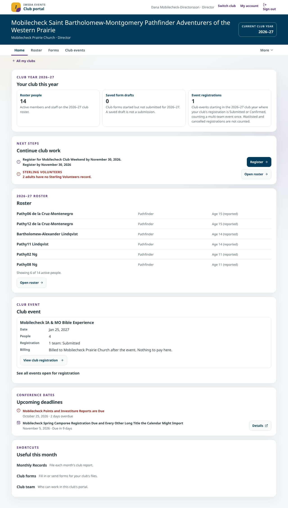
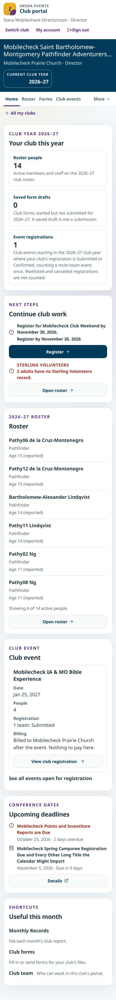
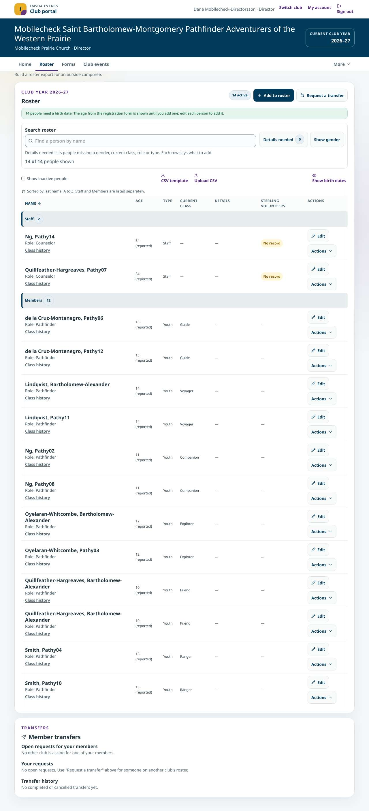
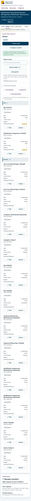
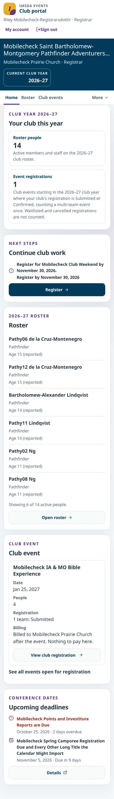
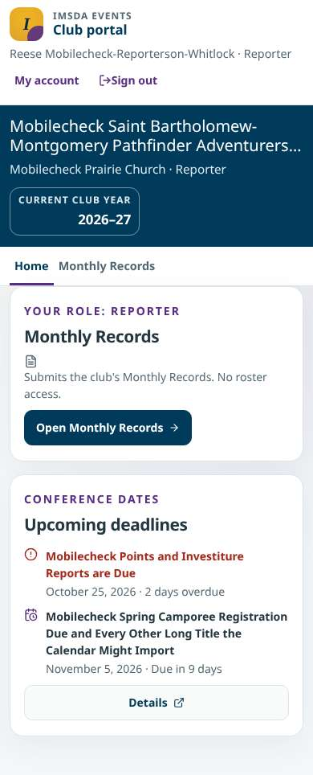
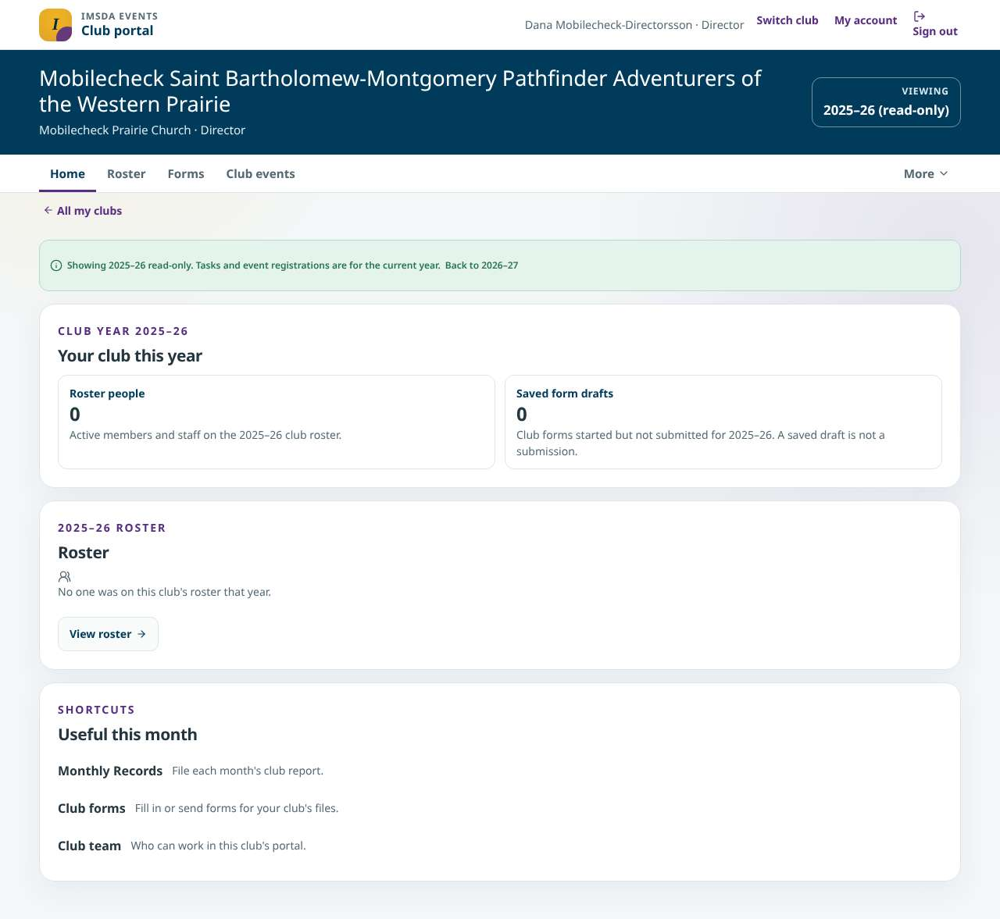

# Director portal implementation evidence (#1112)

Issue: [#1112](https://github.com/DurantTL/IMSDA-Events/issues/1112). It was built in three slices: [#1165](https://github.com/DurantTL/IMSDA-Events/issues/1165) (club masthead, club/year banner and Home · Roster · Forms · Club events · More), [#1166](https://github.com/DurantTL/IMSDA-Events/issues/1166) (task-first Home) and [#1167](https://github.com/DurantTL/IMSDA-Events/issues/1167) (roster search, Details needed, phone cards, labelled Edit / Actions). [#1101](https://github.com/DurantTL/IMSDA-Events/issues/1101) separately delivered the protected roster editor close. This page records what the delivered pages show and how each acceptance criterion was checked. The #1112 wrap-up change adds three things:

- the club navigation keeps a read-only past or next club year on Home and Roster;
- the phone-layout audit signs in a registrar and a reporter;
- the roster and Honors name search no longer push the page sideways at 200% text on a phone.

All screenshots come from a local production build with synthetic `mobilecheck` data, taken on October 28, 2026. They show this build, not a deployment.

## Fixtures

The phone-layout audit (`scripts/verify-mobile-layout.ts`) signs in three club accounts. Club A has a deliberately long name, 14 roster people and one church-billed club event registration.

| Account | Grant | What it proves |
|---|---|---|
| `mobilecheck_account_director` (Dana Mobilecheck-Directorsson) | Director of club A and club B | The full director shell, Switch club, every More tool, and past-year (read-only) Home and Roster |
| `mobilecheck_account_registrar` (Riley Mobilecheck-Registrarsdottir) | Registrar of club A | Roster and club events only: no Forms, Health, Monthly Records, club settings or saved-draft count |
| `mobilecheck_account_reporter` (Reese Mobilecheck-Reporterson-Whitlock) | Reporter of club A | Home and Monthly Records only, with no roster or event data |

New audit pages: `club-registrar-home`, `club-registrar-roster`, `club-reporter-home`, `club-reporter-monthly-records`, `club-home-past-year` and `club-roster-past-year`. Each checks text that proves the role or year really rendered.

## Screenshots

| | |
|---|---|
| Director Home, desktop |  |
| Director Home, phone (390px) |  |
| Roster, desktop |  |
| Roster, phone (person cards) |  |
| Registrar Home, phone |  |
| Reporter Home, phone |  |
| Past club year Home (read-only), desktop |  |

## Acceptance criteria and checks

1. **Masthead, club/year banner, task-first Home, primary and More navigation on existing routes, no platform administration.**
   - The shell is one layout for every club route. The banner shows the club, sponsoring church, actual role and club year.
   - The navigation is regrouped from the existing capability lists. It is not a second permission registry.
   - Checked by `tests/club-shell-nav-1165.test.ts` ("never lists a platform or staff destination"), `tests/club-shell-masthead-1165.test.ts` (My account, Switch club only with more than one club, nothing during a staff act-as or a pending second step) and the screenshots.
   - **Year context (this change):** opening Home or Roster for a past or next club year (`?year=`) keeps that year on the Home and Roster links. Other tools are current-year only, so they open at the current year and the banner says "Current club year".
   - Checked by `tests/club-nav-year-1112.test.ts` and on the build: from the 2025–26 Home, Roster opened `roster?year=2025-26` and the banner kept "Viewing 2025–26 (read-only)".
2. **Director/deputy, registrar and reporter variants; direct requests stay denied.**
   - `tests/club-shell-nav-1165.test.ts` pins each role's destinations to what it had before the shell. A registrar gets no Forms, Health, Monthly Records or Club settings. A reporter gets Home and Monthly Records.
   - `tests/club-shell-denied-routes-1165.test.ts` covers direct requests. A registrar asking for `/forms` or `/club-info` gets the leaders-only notice and no data. A reporter asking for `/roster` gets nothing.
   - The registrar and reporter audit pages above check the same split in a browser.
3. **Content from the selected club/year, with real lifecycle and billing meaning.**
   - `tests/club-home-1166.test.ts` covers this. Every count has a definition, and Home counts only Submitted or Confirmed registrations on events in the selected year.
   - A church-billed event says "Billed to <church> after the event. Nothing to pay here." with View club registration and no payment action. A past year shows that year's roster and no tasks.
4. **Forms, Monthly Records and event registration stay distinct; a draft is not a submission.**
   - The saved-draft count reads "A saved draft is not a submission."
   - A draft task says Continue form, a due record links to Monthly Records, and an event step says Register. Each comes from its own service (`tests/club-home-1166.test.ts`, "Home by role").
5. **Roster search, filter, reset and phone cards; #1101 close protection.**
   - `tests/club-roster-search-1167.test.ts` covers:
     - search over long, accented and duplicate names;
     - one population for the Details needed count and rows;
     - an empty result with a reset;
     - no birthday pills, and many Honors as one button;
     - phone cards with name, role, age and Edit;
     - person-specific Edit / Actions names, and no edit controls on read-only rows.
   - `tests/roster-dirty-close-1101.test.ts` covers Keep editing / Discard on Close, Cancel, Escape and while saving.
6. **Keyboard, More, focus, empty and error states, long content, text enlargement, narrow screens.** Playwright pass on this build, October 28, 2026:
   - **More by keyboard:** on Honors (reached through More), the button reads "More (current page: Honors)". Enter opens it, Tab moves into the list with a visible focus ring, and Escape closes it and returns focus to More. The unit test covers the same behavior, plus closing when focus leaves.
   - **200% text before this change:** at 390px the director's and registrar's Roster scrolled sideways by 69px, and Honors by 64px. Both name-search boxes sat in grid tracks that grew to the input's natural width.
   - **200% text after this change:** with the rule added in `app/globals.css`, Roster, Honors and Class tracking have no horizontal page scroll for the director and the registrar, at 360, 390 and 1280px and at 100% and 200% text. The search boxes stay at least 44px tall.
   - **Other pages at 200% text:** Home, past-year Home and the reporter's Monthly Records already fit.
   - **Empty, error and read-only states** are unit-tested in `tests/club-home-1166.test.ts`: a new club with nothing on it, drafts or events failing to load, roster failure, and a past year.
   - **Phone-layout audit:** it passes for every `club-` page, including the new role and past-year pages, at 360, 390, 1024 and 1280px.
7. **Screenshots and recorded checks.** This page.

## Prototype interactions left with their existing owners

- **Roster search and filter state** is not restored when returning from a person or event page. #1167 chose never to save search or filters, so it isn't carried over. Returning lands on the same club and year, because back links stay inside the club.
- **There is no in-page year picker.** A past or next year is still reached the existing ways: the read-only notice, the next-year roster offer and its links. This change only keeps that year while moving between Home and Roster.
- **The prototype's local saves and its sample-role picker** are not product controls. Saving a draft uses the real club forms service, and the role comes only from the person's grant.
- **Future club billing, assignments, reports and messages** remain with #194.
