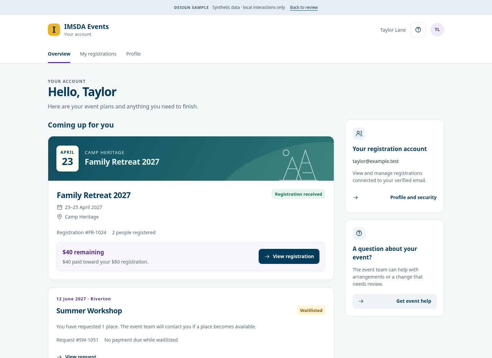
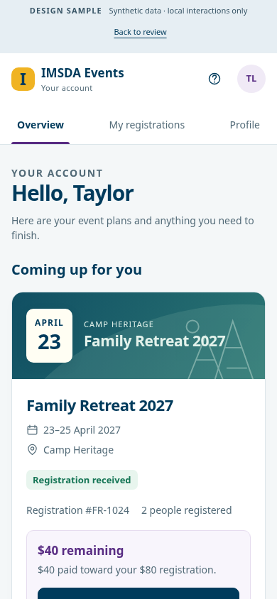

# Attendee portal: implement the approved personal registration layout and lifecycle-aware next actions

## Outcome and ownership

Give an ordinary attendee a clear personal account: their registrations, what each registration means, what they can do next, and where to get help. The user accepted the corrected role-specific examples and requested implementation issues with the design context captured here. The attendee shares IMSDA branding and accessible controls with the other roles; its information hierarchy and navigation are its own.

This is a bounded presentation/interaction child of #109 and #99, tracked in the role-design follow-up #1109. It does not replace #109's broader future family, assignment, pass, message or task work. Keep #1100 as the independent lifecycle-display correction; reuse its result here. Suggested planning labels: `phase-1`, `mobile-check`. Capture the accepted direction without adding another design-approval gate; enter implementation through the normal #98 queue rather than applying `codex-ready` automatically.

## Approved visual reference

- [Four-role design notes](../design-notes.md), [source-based role contract](../evidence/role-contract.md), and [comparison PDF](../comparison.pdf).
- [Interactive attendee example](../interactive-prototype.zip). The example uses local demonstration data/actions, not production API behavior.
- [Shared example controls/styles](../interactive-prototype.zip) and [interaction demonstration](../interactive-prototype.zip) explain the intended behavior, not a requirement to ship static HTML or duplicate the current components.

The interactive links download the offline prototype archive. Extract it, then open `role-design-samples.html` or `prototype/attendee.html`; the referenced CSS/JavaScript are inside `prototype/`. No build or server is required.

The ordinary sample account is **Taylor Lane**, with no club, coordinator or staff grant. The gallery's review links and sample-role links live outside the product and must not become a universal role switcher.

## Page anatomy and navigation

1. Use a compact, light IMSDA account header with the actual signed-in person's identity, existing account/help controls and sign-out. Keep the ordinary attendee's primary tabs **Overview**, **My registrations**, and **Profile**. Display other workspace entry points only when existing authorization grants them.
2. Lead Overview with a personal greeting and upcoming registration cards. Use a readable event name, date/location, registration state and one primary next action. The leading card is a registration for an event, not a staff event-management dashboard.
3. Put personal account/help information in a secondary desktop column. Keep event-specific support with the relevant event or registration. On a phone, use a single column with the registration and its next action before secondary profile/help content.
4. Keep My registrations useful as the complete personal history. Separate upcoming/active work from past/cancelled history; preserve understandable empty and filtered-empty states. A labelled disclosure may reduce history noise, but must remain keyboard-operable and retain visible counts/status where helpful.
5. Profile covers the signed-in account's existing editable information and security entry point. Show verified-email meaning accurately. Registration contact/answers remain in their permitted registration workflow; a profile edit must not silently rewrite unrelated submitted registrations.

Keep the shared IMSDA Noto Sans typography, navy/purple/gold identity, light surfaces, restrained card borders and consistent controls. Use readable body/help text and visible focus; reproduce the hierarchy and breathing room rather than hardcoding every prototype pixel or decorative small label.

## Registration cards and interactions

Each accessible registration should identify its event, date/location, confirmation code where appropriate, included people, lifecycle state, financial meaning and permitted next action. Make **View registration** the clear default, linking into the existing account event/registration workflow. Secondary actions should be contextual rather than a wall of equally prominent buttons.

- The approved direct-billing **Family Retreat** example shows two registered people and `Registration received` for a submitted registration. Do not convert submitted into a guarantee of confirmation, attendance or payment completion. Its illustrative $80 total, $40 paid and $40 remaining demonstrate labels; production values come from the existing domain.
- A **waitlisted** record says the place is unconfirmed and does not present its historical quoted amount as money currently due. Do not offer a continue-payment action while payment is unavailable for that lifecycle state.
- A **cancelled** record retains original charges, payment and refund history, while saying no payment is currently due. Its date alone must not make it the next active event. A past paid registration remains available as read-only history/receipt where current services permit.
- Distinguish direct payment from deferred/church billing using current domain meaning. Continue payment appears only when the existing service permits it; never infer the signed-in person is the debtor for an organization invoice.
- Detail/actions must reuse existing editability, payment, cancellation and refund boundaries. A cancellation request is a request through the existing service, not staff approval or refund issuance. Preserve the current confirmation and error behavior.

Use plain-text status labels as well as color. Handle long event names, names/contact values, multiple included people and event-support content without clipped essential information. Do not add invented completion scores, missing-form counts, assignments or badges when the backing domain has not modeled them.

## Data, routes and permission contract

Improve the delivered account foundation rather than creating a second dashboard or login system:

| Destination / foundation | Preserve while changing presentation |
| --- | --- |
| `/account` | Personal overview, current account shell and genuine authorized workspace links |
| `/account/registrations` | The account's accessible registrations and lifecycle-aware history |
| `/account/profile` | Existing profile/security semantics, verification and persistence |
| `/account/events/[eventSlug]` | Existing accessible event hub and registration actions |
| `/manage/[token]` and existing recovery | Account-free private registration management remains available; this redesign must not require creating an account |

Use the authenticated verified-email/current access rules for account matching. Multiple people included on one registration do not create a permanent household, guardian grant or access to their other records. Do not add directory search, attendee-wide lookup, all-events administration, staff queues, refund controls or role management to this portal. Page/API authorization remains authoritative even when a navigation link is hidden. Unauthorized, expired-link and revoked-access states must avoid disclosing other accounts or records.

Source baseline for review (immutable, not a claim of deployment):

- [Account shell](https://github.com/DurantTL/IMSDA-Events/blob/8eb81d7d510b5225c9d70d5cd3ecf1f721515484/app/%28public%29/account/%28portal%29/layout.tsx) and [current overview](https://github.com/DurantTL/IMSDA-Events/blob/8eb81d7d510b5225c9d70d5cd3ecf1f721515484/app/%28public%29/account/%28portal%29/page.tsx#L33).
- [Registration cards/actions](https://github.com/DurantTL/IMSDA-Events/blob/8eb81d7d510b5225c9d70d5cd3ecf1f721515484/app/%28public%29/account/%28portal%29/registrations/page.tsx).
- [Verified-email matching](https://github.com/DurantTL/IMSDA-Events/blob/8eb81d7d510b5225c9d70d5cd3ecf1f721515484/modules/attendee-accounts/registrations-repository.ts#L67) and [account registration projection](https://github.com/DurantTL/IMSDA-Events/blob/8eb81d7d510b5225c9d70d5cd3ecf1f721515484/modules/attendee-accounts/registrations-repository.ts#L399).
- [Existing payment/lifecycle meaning](https://github.com/DurantTL/IMSDA-Events/blob/8eb81d7d510b5225c9d70d5cd3ecf1f721515484/modules/public-access/domain.ts#L161).

## Responsive, keyboard and recovery behavior

- At phone widths, keep the header and three-tab navigation within the viewport, cards readable, the primary task easy to find, and touch targets at least 44px. Do not shrink a desktop administration layout to fit the screen. Check long text and browser text enlargement.
- Use semantic headings, links for navigation and buttons for actions. Provide visible focus, an understandable tab order, associated form labels, announced validation/save/error feedback, and status meaning that does not rely on color.
- Any dialog or history disclosure must work by keyboard. Dialog focus enters appropriately, remains contained, and returns to its trigger; Escape respects unsaved/saving safeguards where an editor is involved.
- Show a calm no-registrations state with an appropriate event-discovery/help link. Keep load/retry, unavailable event, failed save, expired session and payment-return states intelligible, retaining user input where existing workflows support it. Do not replace confirmed server success with a prototype-style local-only success message.

## Dependencies and explicit limits

#1100 owns correcting lifecycle balance/next-event calculations and should remain independently deliverable. This issue consumes that corrected presentation rather than duplicating it; integrate the fix before claiming the approved payment examples are implemented. #61 owns private management/recovery, and its existing working routes are a compatibility boundary, not a requirement to rebuild or finish its entire broader scope first. #109/#99 retain future household, cross-event hub, assignments, passes/messages and additional feature modeling; those are not blockers to improving the available personal account now.

The synthetic names, events, dates, counts and amounts intentionally exercise ordinary, waitlisted, cancelled/refunded and past states. They are fixtures for design review and verification, not constants, production counts, promised billing policy or seed data to deploy.

## Acceptance criteria

- [ ] Implement the accepted personal header/tabs, event-first hierarchy, secondary account/help area and phone composition on the existing account routes, with the ordinary attendee free of staff/club/admin navigation.
- [ ] Render only registrations/actions allowed by existing verified-email and access rules; demonstrate a plain attendee and an account with a genuine additional workspace without granting new authority.
- [ ] Demonstrate submitted, confirmed, waitlisted, cancelled/refunded and past examples using existing lifecycle meaning. Upcoming selection and money-due presentation agree with #1100; historical charges/refunds remain understandable.
- [ ] Confirm permitted view/edit/payment/cancellation links enter current workflows, including account-free private management compatibility. Show error/empty/loading or retry behavior relevant to the changed surfaces.
- [ ] Verify keyboard navigation, status announcements, visible focus, dialog return/containment where used, long content, text enlargement and narrow-screen layout. No essential task requires horizontal page scrolling.
- [ ] Attach representative desktop/phone implementation screenshots and record targeted automated/manual checks of the changed routes and authorization/lifecycle boundaries. The comparison example is a reference, not evidence that production behavior has shipped.
