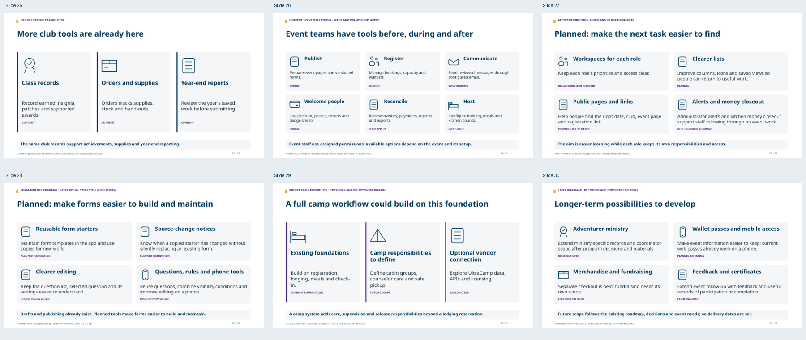
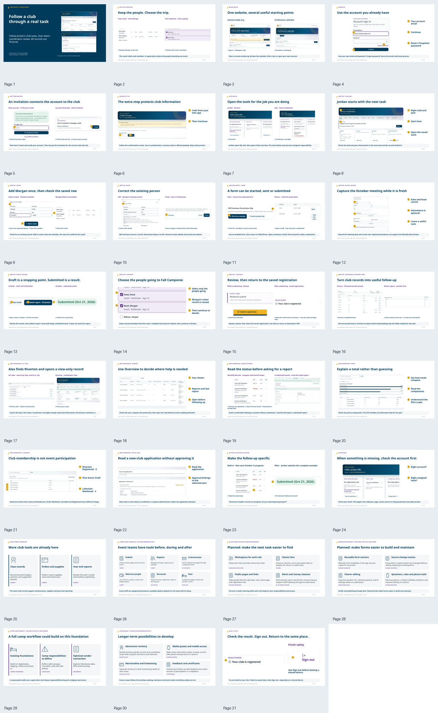

# IMSDA Events — documentation and training pack

Prepared October 21, 2026. The reference reports use source baseline: [main `5e367b7c`](https://github.com/DurantTL/IMSDA-Events/commit/5e367b7c4d1b3c173d37c0415e335be76170b300).

This pack explains the current system, consolidates accessibility/usability findings, supplies practical help and communication drafts, and separates future possibilities from implemented behavior. Camp-system/UltraCamp discovery and the technical verification report are separate documents so each can be shared with the right audience.

## Start with the user orientation

- [Getting started PowerPoint — 31 slides with screenshots, feature outlook and spoken notes](exports/IMSDA-Events-platform-briefing.pptx)
- [Getting started presentation PDF](exports/IMSDA-Events-platform-briefing.pdf)
- [Presenter notes: PDF](exports/06-presenter-notes.pdf) · [Word](exports/06-presenter-notes.docx) · [Markdown](content/06-presenter-notes.md)
- [Screenshot gallery — 34 fictional training capture examples](exports/IMSDA-Events-training-screenshot-gallery.html)

- [Quick-start handout — 3 pages](exports/07-club-quick-start.pdf) · [Editable Word](exports/07-club-quick-start.docx) · [Markdown](content/07-club-quick-start.md)

The presentation follows a fictional club through the current application: director Jordan Ellis adds Morgan Reed to Riverton Pathfinders, records an October meeting and registers people for Fall Camporee. Area Coordinator Alex Morgan then reviews club progress, report statuses and event participation. Screenshots use fictional records in an isolated local application; short annotations show where to act and how to recognize a saved result. Presenter notes carry the fuller explanation, optional demonstration and questions.

**Choose a route:** slides 1–7 introduce the system and sign-in; 8–16 follow the director; 17–22 follow the Area Coordinator; 23–24 cover follow-up and help; 25–30 add other current tools, planned improvements and future possibilities; 31 finishes safely. A single-role session can use its section after the common introduction. Screenshots and current labels use [source `7f77c1df`](https://github.com/DurantTL/IMSDA-Events/commit/7f77c1dfeadd004deb51f91e2bae1b6c4754638b), whose application source matches the earlier baseline. The capture/source register is [screenshot-capture.json](evidence/screenshot-capture.json).

**Training scenario:** October 21, 2026, club year 2026–27. September records illustrate overdue status differences; October's record is still within its submission period. Fall Camporee takes place November 6–8. Names, clubs, contacts, figures and event records are fictional. These local captures verify repository behavior, not the configuration or data currently serving on the public production site.

The six optional closing slides cover other current club/event tools, planned workspace and form-builder work, and longer-term possibilities such as camp operations, Adventurer support, wallet passes, merchandise, fundraising and feedback. Current, planned and possible are labelled separately; no delivery dates are promised. For a task-only orientation, use slides 1–24 and 31. Detailed technical evidence, future-feature planning and camp discovery remain in the separate reports below.

## Prepared documents

| Document | Best audience and contents | PDF | Editable Word | Source |
|---|---|---|---|---|
| Current capabilities and future possibilities | Organizers, leadership and trainers. 37 feature groups, status/owner mapping, role boundaries and navigation to existing project materials. | [7 pages](exports/01-current-and-future-features.pdf) | [DOCX](exports/01-current-and-future-features.docx) | [Markdown](content/01-current-and-future-features.md) |
| Accessibility and usability review | Product/design reviewers and implementers. 14 findings with existing owners, impact, acceptance examples and relevant accessibility guidance. | [7 pages](exports/02-accessibility-and-usability.pdf) | [DOCX](exports/02-accessibility-and-usability.docx) | [Markdown](content/02-accessibility-and-usability.md) |
| Help and communication kit | Office staff, trainers and support. Four role quick starts, FAQs, 14 help/copy examples, support handoff and eight unsent message drafts. | [9 pages](exports/03-help-and-communication-kit.pdf) | [DOCX](exports/03-help-and-communication-kit.docx) | [Markdown](content/03-help-and-communication-kit.md) |
| Camp system and UltraCamp discovery | Camp leadership and the person speaking with UltraCamp. 18 operational domains, capability/data-contract questions, operating-model options, meeting agenda and an unsent vendor request. | [8 pages](exports/04-camp-system-and-ultracamp.pdf) | [DOCX](exports/04-camp-system-and-ultracamp.docx) | [Markdown](content/04-camp-system-and-ultracamp.md) |
| Code structure and verification evidence | Technical owners and reviewers. Architecture, domain/data boundaries, authorization, current financial records, versions/outbox/imports, exact CI runs and evidence limits. | [8 pages](exports/05-code-and-verification-evidence.pdf) | [DOCX](exports/05-code-and-verification-evidence.docx) | [Markdown](content/05-code-and-verification-evidence.md) |

## Interpret the status labels

**Implemented** means present in the reviewed repository. **Gated/setup** means code exists with remaining activation/configuration/evidence prerequisites. **Accepted design** means accepted presentation direction awaiting the applicable implementation. **Planned** means future tracked scope with its existing decisions and dependencies. These labels do not establish the serving production state.

The agreed System navigation and distinct attendee, director, coordinator and administrator roles remain authoritative. The orientation uses current application screenshots with numbered instructional annotations; those annotations are presentation aids, not product controls or new menu designs. Accepted future design mockups are not presented as shipped screens. Existing rehearsal plans, decision records and JSON/CSV/PDF examples are indexed in the feature guide rather than duplicated.

UltraCamp's public REST documentation is recorded in the project's prior research; medical/form-readiness API coverage remains unconfirmed. The report explicitly dates that evidence. Fresh vendor verification was unavailable under the execution environment's network policy. All UltraCamp implementation remains Phase 5 under the existing roadmap; the report is discovery material, not a new rollout plan.

The help/message examples are prepared drafts. Square-bracket placeholders are editorial fields; only the separately documented `{{...}}` tokens are supported runtime template tokens. No messages or vendor requests have been sent.

## Verification and evidence

- [Feature evidence matrix](evidence/feature-matrix.json)
- [Usability findings](evidence/usability-findings.json)
- [Help source/token checks](evidence/help-source-map.json)
- [UltraCamp/camp source register](evidence/ultracamp-sources.json)
- [Technical check ledger](evidence/technical-checks.json)
- [Independent content review](evidence/independent-content-qa.md)
- [Export and visual verification](evidence/export-verification.md)
- [User-orientation source and content checks](evidence/orientation-verification.md)
- [Screenshot capture/source register](evidence/screenshot-capture.json)
- [Visual-training review checklist](evidence/visual-training-qa-plan.md)
- [Closing feature source/status audit](evidence/closing-feature-audit.md)
- [Closing slide independent review](evidence/outlook-independent-qa.md)
- [Independent visual-training review](evidence/visual-training-independent-qa.md)
- [Fictional dataset and before/after story](evidence/synthetic-training-dataset.md)

The technical report records **13,504 tests passed and one skipped across 1,015 files** in the exact current-main CI run. It distinguishes main smoke from the separately observed extended application, mobile and badge checks, and from human/physical production verification. No new application test run was started for this documentation task.

The PowerPoint contains embedded screenshot images with editable titles, captions and callout shapes. Its six closing capability diagrams also use editable text and vector shapes, with status-aware captions that distinguish them from current app screenshots. Screenshots are raster captures rather than editable application components. Noto Sans is used in the exports; font files and their license are included under `assets/` for consistent offline HTML viewing. Export-check results are recorded separately in the evidence files; PDF tags alone do not establish PDF/UA or WCAG conformance.

Only documentation and export assets are delivered. Application behavior, menus, permissions, issue labels/states, build order and production switches are unchanged. Follow [#98](https://github.com/DurantTL/IMSDA-Events/issues/98) for implementation order and [#844](https://github.com/DurantTL/IMSDA-Events/issues/844) for the preceding issue review.
