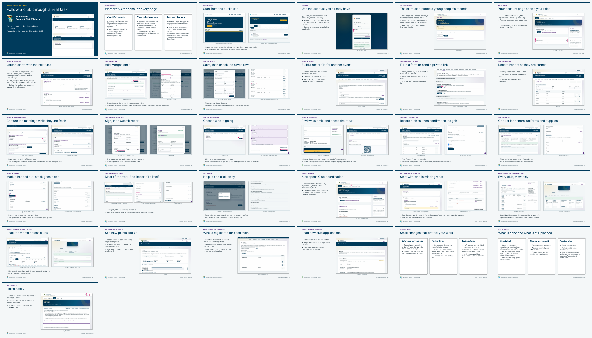

# IMAdventist: documentation and training pack

Prepared November 5, 2026 from [main `ad9237d`](https://github.com/DurantTL/IMSDA-Events/commit/ad9237d). This pack replaces the [October 21 pack](../2026-10-21/README.md), which stays as a historical record.

## What changed from the October 21 pack

- **New name and logo.** Every document, slide and screenshot uses **IMAdventist** (Events & Club Ministry) and the new symbol. The conference name, support@imsda.org and events.imsda.org are unchanged.
- **New screenshots.** All 44 screenshots were retaken from the current app with fictional data. They show the new branding, the merged **Club coordination** area for Area Coordinators, the Security check and Back to events on sign-in, and the Step by step Help guides.
- **New deck.** The getting-started presentation is rebuilt as 31 slides for people who are seeing IMAdventist for the first time. No earlier training is assumed; the October 21 pack was never presented. Slide 2 is a short orientation to what works the same on every page. The story uses Winter Camporee (December 4–6) because Fall Camporee has passed.
- **Rewritten presenter notes and quick-start handout** with today's menu names and buttons.
- **Reference reports 01–05** carry the new name and a dated update note at the top. Report 01 also has corrected status labels for features that shipped since October. Reports 02–05 were **not** re-audited; their findings and evidence are still dated October 21.

## Start with the user orientation

- [Getting started PowerPoint, 31 slides with speaker notes](exports/IMAdventist-getting-started.pptx) · [PDF](exports/IMAdventist-getting-started.pdf)
- Presenter notes: [PDF](exports/06-presenter-notes.pdf) · [Word](exports/06-presenter-notes.docx) · [Web page](exports/06-presenter-notes.html) · [Markdown](content/06-presenter-notes.md)
- Quick-start handout (4 pages): [PDF](exports/07-club-quick-start.pdf) · [Word](exports/07-club-quick-start.docx) · [Web page](exports/07-club-quick-start.html) · [Markdown](content/07-club-quick-start.md)
- [Screenshot gallery, 44 fictional training screenshots](exports/IMAdventist-training-screenshot-gallery.html)

**Choose a route:** slides 1–2 introduce the system for everyone. Slides 3–6 cover the public site and sign-in. Slides 7–21 follow director Jordan Ellis. Slides 22–28 follow Area Coordinator Alex Morgan. Slides 29–31 cover everyday habits, what is planned, and signing out. Directors only: slides 1–21 and 31. Coordinators only: slides 1–6 and 22–31.

## Reference documents

| Document | Audience | PDF | Word | Source |
|---|---|---|---|---|
| Current capabilities and future possibilities | Organizers, leadership and trainers | [PDF](exports/01-current-and-future-features.pdf) | [DOCX](exports/01-current-and-future-features.docx) | [Markdown](content/01-current-and-future-features.md) |
| Accessibility and usability review | Product and design reviewers | [PDF](exports/02-accessibility-and-usability.pdf) | [DOCX](exports/02-accessibility-and-usability.docx) | [Markdown](content/02-accessibility-and-usability.md) |
| Help and communication kit | Office staff, trainers and support | [PDF](exports/03-help-and-communication-kit.pdf) | [DOCX](exports/03-help-and-communication-kit.docx) | [Markdown](content/03-help-and-communication-kit.md) |
| Camp system and UltraCamp discovery | Camp leadership | [PDF](exports/04-camp-system-and-ultracamp.pdf) | [DOCX](exports/04-camp-system-and-ultracamp.docx) | [Markdown](content/04-camp-system-and-ultracamp.md) |
| Code structure and verification evidence | Technical owners and reviewers | [PDF](exports/05-code-and-verification-evidence.pdf) | [DOCX](exports/05-code-and-verification-evidence.docx) | [Markdown](content/05-code-and-verification-evidence.md) |

The October evidence files (feature matrix, usability findings, UltraCamp sources, CI ledger) are in [`../2026-10-21/evidence/`](../2026-10-21/evidence/) and were not copied, because reports 02–05 were not re-audited.

## The fictional training story

Jordan Ellis directs Riverton Pathfinders at Riverton Community Church. Jordan adds Morgan Reed to the roster, files the October Monthly Record, registers 10 people for Winter Camporee, records Avery Chen's Friend class, hands out Drew Patel's Good Conduct Bar and saves a Year-End Report draft. Alex Morgan, an Area Coordinator, then reviews the same records across four fictional clubs. Every name, contact, count and registration is invented. Details: [evidence/synthetic-training-dataset.md](evidence/synthetic-training-dataset.md).

## Verification

- [Screenshot capture register](evidence/screenshot-capture.json): route, state, size and SHA-256 for every screenshot, and the slides that use it.
- [Export and content checks](evidence/export-verification.md).

Only documentation and export files are in this pack. App behavior, menus, permissions, issues and production settings are unchanged. Follow [#98](https://github.com/DurantTL/IMSDA-Events/issues/98) for the build order.
